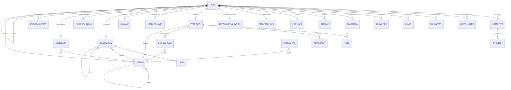

# OpenTravel protobuf reference

> [!IMPORTANT]
> Generated by `just docs` from the OpenTravel 2017B XML message suite and
> code list 2024-09-04, OpenTravel-Specifications revision 2024-11-26 (`28dcc88`).
> Do not edit by hand.

| | |
| --- | --- |
| Packages | 29 (28 resources + the annotation vocabulary) |
| Collections / singletons | 24 / 4 |
| RPCs | 169 |
| Protos | 1504 |

## How the resources relate

> A `||--o{` or `||--||` is *containment*: the child's name extends the
> parent's. A `}o--||` is an *association*: the field holds the other resource's
> name, because AIP-215 forbids naming a message in another package.

## Packages

| Resource | Package | Shape | Pattern |
| --- | --- | --- | --- |
| [Hotel](hotel/hotel/README.md) | `protobuf.opentravel.hotel.hotel.v1` | collection | `hotels/{hotel}` |
| [RoomType](hotel/property/room_type/README.md) | `protobuf.opentravel.hotel.property.room_type.v1` | collection | `hotels/{hotel}/roomTypes/{room_type}` |
| [MeetingRoom](hotel/property/meeting_room/README.md) | `protobuf.opentravel.hotel.property.meeting_room.v1` | collection | `hotels/{hotel}/meetingRooms/{meeting_room}` |
| [Restaurant](hotel/property/restaurant/README.md) | `protobuf.opentravel.hotel.property.restaurant.v1` | collection | `hotels/{hotel}/restaurants/{restaurant}` |
| [Policy](hotel/property/policy/README.md) | `protobuf.opentravel.hotel.property.policy.v1` | collection | `hotels/{hotel}/policies/{policy}` |
| [Promotion](hotel/property/promotion/README.md) | `protobuf.opentravel.hotel.property.promotion.v1` | collection | `hotels/{hotel}/promotions/{promotion}` |
| [Multimedia](hotel/property/multimedia/README.md) | `protobuf.opentravel.hotel.property.multimedia.v1` | collection | `hotels/{hotel}/multimedia/{multimedia}` |
| [Contact](hotel/property/contact/README.md) | `protobuf.opentravel.hotel.property.contact.v1` | collection | `hotels/{hotel}/contacts/{contact}` |
| [AreaInfo](hotel/property/area_info/README.md) | `protobuf.opentravel.hotel.property.area_info.v1` | singleton | `hotels/{hotel}/areaInfo` |
| [AffiliationInfo](hotel/property/affiliation_info/README.md) | `protobuf.opentravel.hotel.property.affiliation_info.v1` | singleton | `hotels/{hotel}/affiliationInfo` |
| [EnvironmentalImpact](hotel/property/environmental_impact/README.md) | `protobuf.opentravel.hotel.property.environmental_impact.v1` | singleton | `hotels/{hotel}/environmentalImpact` |
| [RatePlan](hotel/revenue/rate_plan/README.md) | `protobuf.opentravel.hotel.revenue.rate_plan.v1` | collection | `hotels/{hotel}/ratePlans/{rate_plan}` |
| [HotelProduct](hotel/revenue/hotel_product/README.md) | `protobuf.opentravel.hotel.revenue.hotel_product.v1` | collection | `hotels/{hotel}/hotelProducts/{hotel_product}` |
| [Inventory](hotel/revenue/inventory/README.md) | `protobuf.opentravel.hotel.revenue.inventory.v1` | collection | `hotels/{hotel}/roomTypes/{room_type}/inventories/{inventory}` |
| [Rate](hotel/revenue/rate/README.md) | `protobuf.opentravel.hotel.revenue.rate.v1` | collection | `hotels/{hotel}/ratePlans/{rate_plan}/rates/{rate}` |
| [Restriction](hotel/revenue/restriction/README.md) | `protobuf.opentravel.hotel.revenue.restriction.v1` | collection | `hotels/{hotel}/ratePlans/{rate_plan}/restrictions/{restriction}` |
| [BookingRule](hotel/revenue/booking_rule/README.md) | `protobuf.opentravel.hotel.revenue.booking_rule.v1` | collection | `hotels/{hotel}/ratePlans/{rate_plan}/bookingRules/{booking_rule}` |
| [Summary](hotel/revenue/summary/README.md) | `protobuf.opentravel.hotel.revenue.summary.v1` | collection | `hotels/{hotel}/summaries/{summary}` |
| [Reservation](hotel/booking/reservation/README.md) | `protobuf.opentravel.hotel.booking.reservation.v1` | collection | `hotels/{hotel}/reservations/{reservation}` |
| [Stay](hotel/booking/stay/README.md) | `protobuf.opentravel.hotel.booking.stay.v1` | singleton | `hotels/{hotel}/reservations/{reservation}/stay` |
| [InventoryBlock](hotel/sales/inventory_block/README.md) | `protobuf.opentravel.hotel.sales.inventory_block.v1` | collection | `hotels/{hotel}/inventoryBlocks/{inventory_block}` |
| [Event](hotel/sales/event/README.md) | `protobuf.opentravel.hotel.sales.event.v1` | collection | `events/{event}` |
| [EventReport](hotel/sales/event_report/README.md) | `protobuf.opentravel.hotel.sales.event_report.v1` | collection | `eventReports/{event_report}` |
| [MeetingRfp](hotel/sales/meeting_rfp/README.md) | `protobuf.opentravel.hotel.sales.meeting_rfp.v1` | collection | `meetingRfps/{meeting_rfp}` |
| [TransientRfp](hotel/sales/transient_rfp/README.md) | `protobuf.opentravel.hotel.sales.transient_rfp.v1` | collection | `transientRfps/{transient_rfp}` |
| [Commission](hotel/finance/commission/README.md) | `protobuf.opentravel.hotel.finance.commission.v1` | collection | `hotels/{hotel}/commissions/{commission}` |
| [StatisticReport](hotel/reporting/statistic_report/README.md) | `protobuf.opentravel.hotel.reporting.statistic_report.v1` | collection | `hotels/{hotel}/statisticReports/{statistic_report}` |
| [Profile](common/profile/README.md) | `protobuf.opentravel.common.profile.v1` | collection | `profiles/{profile}` |
