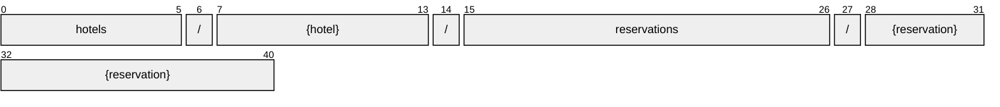

# Reservation

[](https://github.com/OpenTravel/OpenTravel-Specifications)
[](https://github.com/OpenTravel/OpenTravel-Specifications/tree/master/CodeLists)
[](https://aip.dev/121)
[](#methods)
[](v1/)

> [!IMPORTANT]
> Generated by `just docs` from the OpenTravel 2017B XML message suite and
> code list 2024-09-04, OpenTravel-Specifications revision 2024-11-26 (`28dcc88`).
> Do not edit by hand.

Contains a hotel reservation.

OTA: OTA_HotelResRQ/HotelReservations/HotelReservation.

```text
hotels/{hotel}/reservations/{reservation}
```

## Example

A reservation as this API returns it:

```json
{
  "name": "hotels/HOT1/reservations/RES1",
  "uid": "b3f1c2de-4a5b-4c6d-8e9f-0a1b2c3d4e5f",
  "createTime": "2026-10-05T10:15:30Z",
  "updateTime": "2026-10-05T10:15:30Z",
  "roomStayReservation": true,
  "creatorId": "<creator id>",
  "lastModifierId": "<last modifier id>",
  "forcedSellIndicator": true,
  "serviceOverrideIndicator": true,
  "rateOverrideIndicator": true
}
```

## Resource names

Every reservation is addressed by a name that alternates collection and identifier,
per [AIP-122](https://aip.dev/122):



The last segment is assigned by the server, or by the caller as `reservation_id` on create.

## Fields

30 fields: 7 AIP identity and lifecycle, 23 from OTA. Field numbers
8-15 are reserved, so a later identity field never renumbers an OTA one.

| Field | Type | Behavior | OTA | Description |
| --- | --- | --- | --- | --- |
| `room_stay_reservation` | `bool` | `OPTIONAL` | `HotelReservationType/@RoomStayReservation` | Boolean True if this reservation is reserving rooms. |
| `creator_id` | `string` | `OPTIONAL` | `DateTimeStampGroup/@CreatorID` | ID of creator. |
| `last_modifier_id` | `string` | `OPTIONAL` | `DateTimeStampGroup/@LastModifierID` | Identifies the last software system or person to modify a record. |
| `purge_day` | `Date` | `OPTIONAL` | `DateTimeStampGroup/@PurgeDate` | Date an item will be purged from a database (e.g., from a live database to an archive). |
| `state` | `Reservation.State` | `OUTPUT_ONLY` | `HotelReservationType/@ResStatus` | Indicates the status of the reservation. |
| `gds_status_code` | `string` | `OUTPUT_ONLY` | `HotelReservationType/@ResStatus` | A status code OTA carries verbatim when no state applies, such as a GDS's two-letter status (HK, UC). |
| `forced_sell_indicator` | `bool` | `OPTIONAL` | `HotelReservationType/@ForcedSellIndicator` | When true, indicates a sell was forced even if there are restrictions or no availability. |
| `service_override_indicator` | `bool` | `OPTIONAL` | `HotelReservationType/@ServiceOverrideIndicator` | When true, indicates a service has been overridden. |
| `rate_override_indicator` | `bool` | `OPTIONAL` | `HotelReservationType/@RateOverrideIndicator` | When true, indicates a rate has been overridden. |
| `walkin_indicator` | `bool` | `OPTIONAL` | `HotelReservationType/@WalkInIndicator` | When true, indicates the reservation is for a guest that walks-in without a reservation. |
| `room_number_locked_indicator` | `bool` | `OPTIONAL` | `HotelReservationType/@RoomNumberLockedIndicator` | When true, indicates a room number cannot be changed. |
| `original_delivery_method_code` | `DistributionType` | `OPTIONAL` | `HotelReservationType/@OriginalDeliveryMethodCode` | The method by which the original reservation was delivered. |
| `passive_indicator` | `bool` | `OPTIONAL` | `HotelReservationType/@PassiveIndicator` | When true, indicates that this item is included for information only and no action should be taken. |
| `pos` | `repeated Source` | `OPTIONAL` | `HotelReservationType/POS/Source` | Identifies who made the original reservation. |
| `unique_ids` | `repeated UniqueId` | `OPTIONAL` | `HotelReservationType/UniqueID` | Used to provide PMS and/or CRS identifiers. |
| `room_stays` | `repeated RoomStay` | `OPTIONAL` | `HotelReservationType/RoomStays/RoomStay` | Collection of room stays. |
| `services` | `Services` | `OPTIONAL` | `HotelReservationType/Services` | Collection of services. |
| `billing_instruction_codes` | `repeated Reservation.BillingInstructionCode` | `OPTIONAL` | `HotelReservationType/BillingInstructionCode` | Billing codes that apply to a set of instructions for a set of transactions that are routed to a designated folio. |
| `res_guests` | `repeated ResGuest` | `OPTIONAL` | `HotelReservationType/ResGuests/ResGuest` | Collection of guests associated with the reservation. |
| `res_global_info` | `Reservation.ResGlobalInfo` | `OPTIONAL` | `HotelReservationType/ResGlobalInfo` | ResGlobalInfo is a container for various information that affects the Reservation as a whole. |
| `written_conf_inst` | `WrittenConfInst` | `OPTIONAL` | `HotelReservationType/WrittenConfInst` | To indicate a confirmation is to be sent for this reservation. |
| `queue` | `Reservation.Queue` | `OPTIONAL` | `HotelReservationType/Queue` | Information to specify the queue on which the reservation should be placed. |
| `rebate_programs` | `repeated Rebate` | `OPTIONAL` | `HotelReservationsType/HotelReservation/RebatePrograms/RebateProgram` | Collection of rebate programs the hotel participates in. |

<details>
<summary>Identity and lifecycle -- the fields every resource carries</summary>

| Field | Type | Behavior | Description |
| --- | --- | --- | --- |
| `name` | `string` | `IDENTIFIER` | Resource name, "hotels/{hotel}/reservations/{reservation}". |
| `uid` | `string` | `OUTPUT_ONLY` | Server-assigned unique id. |
| `etag` | `string` | `OUTPUT_ONLY` | Weak validator for optimistic concurrency, AIP-154 <https://aip.dev/154>. |
| `delete_time` | `google.protobuf.Timestamp` | `OUTPUT_ONLY` | When this resource was soft-deleted, unset while it is live. |
| `expire_time` | `google.protobuf.Timestamp` | `OUTPUT_ONLY` | When a soft-deleted resource is purged for good. |
| `create_time` | `google.protobuf.Timestamp` | `OUTPUT_ONLY` | When this resource was created. |
| `update_time` | `google.protobuf.Timestamp` | `OUTPUT_ONLY` | When this resource was last modified. |

</details>

## Methods

Service `Reservations`, the AIP-131..135 standard methods plus [AIP-164](https://aip.dev/164) undelete:

| RPC | HTTP | Description |
| --- | --- | --- |
| `GetReservation` | `GET /v1/{name=hotels/*/reservations/*}` | Retrieves one Reservation. |
| `UpdateReservation` | `PATCH /v1/{reservation.name=hotels/*/reservations/*}` | Updates a Reservation. Only the fields in update_mask are written. |
| `ListReservations` | `GET /v1/{parent=hotels/*}/reservations` | Lists reservations, paginated per AIP-158 <https://aip.dev/158>. |
| `CreateReservation` | `POST /v1/{parent=hotels/*}/reservations` | Creates a Reservation. |
| `DeleteReservation` | `DELETE /v1/{name=hotels/*/reservations/*}` | Soft-deletes a Reservation; it is purged at expire_time unless restored. |
| `UndeleteReservation` | `POST /v1/{name=hotels/*/reservations/*}:undelete` | Restores a soft-deleted Reservation before it is purged. |
| `CancelReservation` | `POST /v1/{name=hotels/*/reservations/*}:cancel` | Cancels a reservation: state moves to CANCELLED and the reservation is kept, with its cancellation number. OTA_CancelRQ. |
| `QuoteReservation` | `POST /v1/{parent=hotels/*}/reservations:quote` | Prices a reservation without booking it. OTA_HotelResRQ with ResStatus Quote. |
| `HoldReservation` | `POST /v1/{name=hotels/*/reservations/*}:hold` | Holds a reservation's inventory without confirming it. OTA_HotelResRQ with ResStatus Hold. |
| `CommitReservation` | `POST /v1/{name=hotels/*/reservations/*}:commit` | Confirms a reservation created in the pending state. OTA_HotelResRQ with ResStatus Commit. |
| `IgnoreReservation` | `POST /v1/{name=hotels/*/reservations/*}:ignore` | Abandons a pending reservation, releasing its inventory. OTA_HotelResRQ with ResStatus Ignore. |
| `ImportReservations` | `POST /v1/{parent=hotels/*}/reservations:import` | Books a group or tour rooming list against the hotel's blocks. OTA_HotelRoomListRQ. |

## Code tables

Enums numbered by their OTA code, so the wire carries exactly what OTA's XML
does ([decisions](../../../../../docs/decisions.md)):

| Table | Name | Enum | Codes |
| --- | --- | --- | --- |
| `ADT` | Additional Detail Type | `AdditionalDetailType` | 75 |
| `AQC` | Age Qualifying Code | `AgeQualifyingCode` | 21 |
| `ARC` | Architectural Style Code | `ArchitecturalStyleCode` | 14 |
| `AUT` | Address Use Type | `AddressUseType` | 13 |
| `BCT` | Booking Channel Type | `BookingChannelType` | 9 |
| `BED` | Bed Type | `BedType` | 16 |
| `BUS` | Business Srvc Type | `BusinessSrvcType` | 103 |
| `CFC` | Content Format Code | `ContentFormatCode` | 20 |
| `CHG` | Charge Type | `ChargeType` | 34 |
| `CLT` | Communication Location Type | `CommunicationLocationType` | 4 |
| `DOC` | Document Type | `DocumentType` | 25 |
| `DTB` | Distribution Type | `DistributionType` | 16 |
| `EAT` | Email Address Type | `EmailAddressType` | 8 |
| `EMP` | Employee Status | `EmployeeStatusCode` | 4 |
| `EWT` | Error Warning Type | `ErrorWarningType` | 13 |
| `FTT` | Fee Tax Type | `FeeTaxType` | 70 |
| `GRI` | Guest Room Info | `GuestRoomInfo` | 91 |
| `HAC` | Hotel Amenity Code | `HotelAmenityCode` | 504 |
| `INF` | Information Type | `InfoType` | 26 |
| `IPC` | Index Point Code | `IndexPointCode` | 33 |
| `MPT` | Meal Plan Type | `MealPlanType` | 27 |
| `MRC` | Meeting Room Code | `MeetingRoomCode` | 220 |
| `NAM` | Name Type | `NameType` | 4 |
| `OPR` | Additional Operation Info | `AdditionalOperationInfo` | 6 |
| `OTC` | Option Type Code | `OptionTypeCode` | 10 |
| `PAC` | Position Accuracy | `PositionAccuracy` | 12 |
| `PHY` | Disability Feature Code | `DisabilityFeatureCode` | 170 |
| `PIC` | Picture Category Code | `PictureCategoryCode` | 29 |
| `PLT` | Phone Location Type | `PhoneLocationType` | 10 |
| `PMT` | Payment Type | `PaymentType` | 50 |
| `PRT` | Profile Type | `ProfileType` | 23 |
| `PTT` | Phone Technology Type | `PhoneTechnologyType` | 8 |
| `PUT` | Phone Use Type | `PhoneUseType` | 10 |
| `RBT` | Reservation Billing Type | `ReservationBillingType` | 5 |
| `RLT` | Room Location Type | `RoomLocationType` | 31 |
| `RMA` | Room Amenity Type | `RoomAmenityType` | 378 |
| `RMO` | Rate Mode | `RateMode` | 10 |
| `RPT` | Rate Plan Type | `RatePlanType` | 33 |
| `RST` | Recreation Srvc Type | `RecreationSrvcType` | 155 |
| `RVT` | Room View Type | `RoomViewType` | 45 |
| `SEC` | Security Feature Code | `SecurityFeatureCode` | 155 |
| `SEG` | Segment Category Code | `SegmentCategoryCode` | 23 |
| `TRP` | Transportation Code | `TransportationCode` | 33 |
| `TVS` | Travel Sector | `TravelSector` | 11 |
| `UIT` | Unique Id Type | `UniqueIdType` | 44 |
| `UOM` | Unit of Measure Code | `UnitOfMeasureCode` | 29 |
