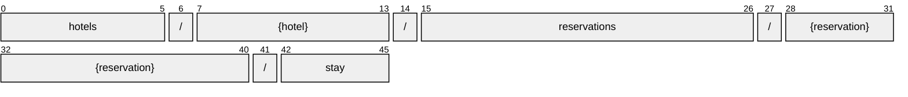

# Stay

[](https://github.com/OpenTravel/OpenTravel-Specifications)
[](https://github.com/OpenTravel/OpenTravel-Specifications/tree/master/CodeLists)
[](https://aip.dev/156)
[](#methods)
[](v1/)

> [!IMPORTANT]
> Generated by `just docs` from the OpenTravel 2017B XML message suite and
> code list 2024-09-04, OpenTravel-Specifications revision 2024-11-26 (`28dcc88`).
> Do not edit by hand.

Provides details of a guest's stay.

OTA: OTA_HotelStayInfoNotifRQ/StayInfos/StayInfo.

```text
hotels/{hotel}/reservations/{reservation}/stay
```

## Example

A stay as this API returns it:

```json
{
  "name": "hotels/HOT1/reservations/RES1/stay",
  "uid": "b3f1c2de-4a5b-4c6d-8e9f-0a1b2c3d4e5f",
  "createTime": "2026-10-05T10:15:30Z",
  "updateTime": "2026-10-05T10:15:30Z",
  "sequenceNumber": 1,
  "roomStayRph": 1
}
```

## Resource names

Every stay is addressed by a name that alternates collection and identifier,
per [AIP-122](https://aip.dev/122):



A singleton ([AIP-156](https://aip.dev/156)): its name ends in a literal, because a
parent has exactly one, so there is nothing to identify.

## Fields

9 fields: 5 AIP identity and lifecycle, 4 from OTA. Field numbers
8-15 are reserved, so a later identity field never renumbers an OTA one.

| Field | Type | Behavior | OTA | Description |
| --- | --- | --- | --- | --- |
| `sequence_number` | `int32` | `OPTIONAL` | `StayInfoType/@SequenceNumber` | Used to sequence the guest revenue blocks of data used to verify transmission. |
| `room_stay_rph` | `int32` | `OPTIONAL` | `StayInfoType/@RoomStayRPH` | Room stay rph. |
| `loyalty_points_accruals` | `repeated SelectedLoyalty` | `OPTIONAL` | `StayInfoType/LoyaltyPointsAccruals/SelectedLoyalty` | A collection of loyalty points accruals. |
| `revenue_categories` | `repeated RevenueCategory` | `OPTIONAL` | `StayInfoType/RevenueCategories/RevenueCategory` | A collection of RevenueCategory classes that detail the categories of revenue data associated with the StayInfo report. |

<details>
<summary>Identity and lifecycle -- the fields every resource carries</summary>

| Field | Type | Behavior | Description |
| --- | --- | --- | --- |
| `name` | `string` | `IDENTIFIER` | Resource name, "hotels/{hotel}/reservations/{reservation}/stay". |
| `uid` | `string` | `OUTPUT_ONLY` | Server-assigned unique id. |
| `etag` | `string` | `OUTPUT_ONLY` | Weak validator for optimistic concurrency, AIP-154 <https://aip.dev/154>. |
| `create_time` | `google.protobuf.Timestamp` | `OUTPUT_ONLY` | When this resource was created. |
| `update_time` | `google.protobuf.Timestamp` | `OUTPUT_ONLY` | When this resource was last modified. |

</details>

## Methods

Service `Stays`, a singleton's complete set ([AIP-156](https://aip.dev/156)):

| RPC | HTTP | Description |
| --- | --- | --- |
| `GetStay` | `GET /v1/{name=hotels/*/reservations/*/stay}` | Retrieves one Stay. |
| `UpdateStay` | `PATCH /v1/{stay.name=hotels/*/reservations/*/stay}` | Updates a Stay. Only the fields in update_mask are written. |

## Code tables

Enums numbered by their OTA code, so the wire carries exactly what OTA's XML
does ([decisions](../../../../../docs/decisions.md)):

| Table | Name | Enum | Codes |
| --- | --- | --- | --- |
| `RCC` | Revenue Category Code | `RevenueCategoryCode` | 36 |
