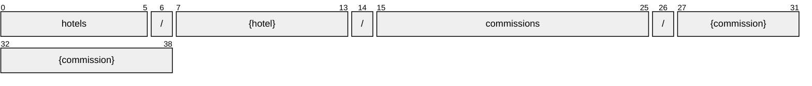

# Commission

[](https://github.com/OpenTravel/OpenTravel-Specifications)
[](https://github.com/OpenTravel/OpenTravel-Specifications/tree/master/CodeLists)
[](https://aip.dev/121)
[](#methods)
[](v1/)

> [!IMPORTANT]
> Generated by `just docs` from the OpenTravel 2017B XML message suite and
> code list 2024-09-04, OpenTravel-Specifications revision 2024-11-26 (`28dcc88`).
> Do not edit by hand.

The CommissionEvent element is used to identify the commission to be paid to a central server. The Commission Event is initiated on the schedule that the hotel typically pays commissions (e.g.: following night audit), and a CommissionEvent occurs for every check out.

OTA: OTA_HotelCommNotifRQ/CommissionEvents/CommissionEvent.

```text
hotels/{hotel}/commissions/{commission}
```

## Example

A commission as this API returns it:

```json
{
  "name": "hotels/HOT1/commissions/COM1",
  "uid": "b3f1c2de-4a5b-4c6d-8e9f-0a1b2c3d4e5f",
  "createTime": "2026-10-05T10:15:30Z",
  "updateTime": "2026-10-05T10:15:30Z",
  "duration": "<duration>",
  "confirmationId": "<confirmation id>",
  "confirmationOriginatorCode": "<confirmation originator code>",
  "commissionOriginatorCode": "<commission originator code>",
  "reservationId": "<reservation id>",
  "preferredPaymentCurrency": "<preferred payment currency>"
}
```

## Resource names

Every commission is addressed by a name that alternates collection and identifier,
per [AIP-122](https://aip.dev/122):



The last segment is assigned by the server, or by the caller as `commission_id` on create.

## Fields

29 fields: 7 AIP identity and lifecycle, 22 from OTA. Field numbers
8-15 are reserved, so a later identity field never renumbers an OTA one.

| Field | Type | Behavior | OTA | Description |
| --- | --- | --- | --- | --- |
| `amount` | `Money` | `OPTIONAL` | `CurrencyAmountGroup/@Amount` | A monetary amount. |
| `start` | `DateOrTimeOrDateTime` | `OPTIONAL` | `DateTimeSpanGroup/@Start` | The starting value of the time span. |
| `duration` | `string` | `OPTIONAL` | `DateTimeSpanGroup/@Duration` | The duration datatype represents a combination of year, month, day and time values representing a single duration of time, encoded as a single string. |
| `end` | `DateOrTimeOrDateTime` | `OPTIONAL` | `DateTimeSpanGroup/@End` | The ending value of the time span. |
| `confirmation_id` | `string` | `OPTIONAL` | `CommissionEventType/@ConfirmationID` | Confirmation id. |
| `confirmation_originator_code` | `string` | `OPTIONAL` | `CommissionEventType/@ConfirmationOriginatorCode` | Confirmation originator code. |
| `commission_originator_code` | `string` | `OPTIONAL` | `CommissionEventType/@CommissionOriginatorCode` | Commission originator code. |
| `reservation_id` | `string` | `OPTIONAL` | `CommissionEventType/@ReservationID` | Reservation id. |
| `original_booking_day` | `Date` | `OPTIONAL` | `CommissionEventType/@OriginalBookingDate` | Original booking date. |
| `preferred_payment_currency` | `string` | `OPTIONAL` | `CommissionEventType/@PreferredPaymentCurrency` | Indicates the preferred currency of the commission to be paid. |
| `market_code` | `string` | `OPTIONAL` | `CommissionEventType/@MarketCode` | Market code. |
| `booking_source` | `string` | `OPTIONAL` | `CommissionEventType/@BookingSource` | Booking source. |
| `room_count` | `int32` | `OPTIONAL` | `CommissionEventType/@NumberOfRooms` | Number of rooms. |
| `room_inventory_code` | `string` | `OPTIONAL` | `CommissionEventType/@RoomInventoryCode` | Room inventory code. |
| `promotion_code` | `string` | `OPTIONAL` | `CommissionEventType/@PromotionCode` | Promotion code. |
| `unique_id` | `UniqueId` | `OPTIONAL` | `CommissionEventType/UniqueID` | Unique id. |
| `profile_certification` | `ProfileCertification` | `OPTIONAL` | `CommissionEventType/ProfileCertification` | The ProfileCertification element identifies the travel agency to be paid by providing the IATA number or ARC certifying number. |
| `profiles` | `repeated string` | `OPTIONAL` | `CommissionEventType/Profiles/Profile` | A collection of profiles. |
| `payee` | `PersonName` | `OPTIONAL` | `CommissionEventType/Payee` | Payee. |
| `payee_address` | `Address` | `OPTIONAL` | `CommissionEventType/PayeeAddress` | Payee address. |
| `commissions` | `repeated CommissionDetail` | `OPTIONAL` | `CommissionEventType/Commissions/Commission` | A collection of Commission elements. |
| `guest_names` | `repeated PersonName` | `OPTIONAL` | `CommissionEventType/GuestNames/GuestName` | A collection of guest names. |

<details>
<summary>Identity and lifecycle -- the fields every resource carries</summary>

| Field | Type | Behavior | Description |
| --- | --- | --- | --- |
| `name` | `string` | `IDENTIFIER` | Resource name, "hotels/{hotel}/commissions/{commission}". |
| `uid` | `string` | `OUTPUT_ONLY` | Server-assigned unique id. |
| `etag` | `string` | `OUTPUT_ONLY` | Weak validator for optimistic concurrency, AIP-154 <https://aip.dev/154>. |
| `delete_time` | `google.protobuf.Timestamp` | `OUTPUT_ONLY` | When this resource was soft-deleted, unset while it is live. |
| `expire_time` | `google.protobuf.Timestamp` | `OUTPUT_ONLY` | When a soft-deleted resource is purged for good. |
| `create_time` | `google.protobuf.Timestamp` | `OUTPUT_ONLY` | When this resource was created. |
| `update_time` | `google.protobuf.Timestamp` | `OUTPUT_ONLY` | When this resource was last modified. |

</details>

## Methods

Service `Commissions`, the AIP-131..135 standard methods plus [AIP-164](https://aip.dev/164) undelete:

| RPC | HTTP | Description |
| --- | --- | --- |
| `GetCommission` | `GET /v1/{name=hotels/*/commissions/*}` | Retrieves one Commission. |
| `UpdateCommission` | `PATCH /v1/{commission.name=hotels/*/commissions/*}` | Updates a Commission. Only the fields in update_mask are written. |
| `ListCommissions` | `GET /v1/{parent=hotels/*}/commissions` | Lists commissions, paginated per AIP-158 <https://aip.dev/158>. |
| `CreateCommission` | `POST /v1/{parent=hotels/*}/commissions` | Creates a Commission. |
| `DeleteCommission` | `DELETE /v1/{name=hotels/*/commissions/*}` | Soft-deletes a Commission; it is purged at expire_time unless restored. |
| `UndeleteCommission` | `POST /v1/{name=hotels/*/commissions/*}:undelete` | Restores a soft-deleted Commission before it is purged. |

## Code tables

Enums numbered by their OTA code, so the wire carries exactly what OTA's XML
does ([decisions](../../../../../docs/decisions.md)):

| Table | Name | Enum | Codes |
| --- | --- | --- | --- |
| `CHG` | Charge Type | `ChargeType` | 34 |
| `CLT` | Communication Location Type | `CommunicationLocationType` | 4 |
| `DOC` | Document Type | `DocumentType` | 25 |
| `NAM` | Name Type | `NameType` | 4 |
| `TVS` | Travel Sector | `TravelSector` | 11 |
| `UIT` | Unique Id Type | `UniqueIdType` | 44 |
