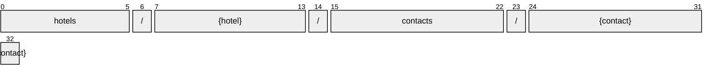

# Contact

[](https://github.com/OpenTravel/OpenTravel-Specifications)
[](https://github.com/OpenTravel/OpenTravel-Specifications/tree/master/CodeLists)
[](https://aip.dev/121)
[](#methods)
[](v1/)

> [!IMPORTANT]
> Generated by `just docs` from the OpenTravel 2017B XML message suite and
> code list 2024-09-04, OpenTravel-Specifications revision 2024-11-26 (`28dcc88`).
> Do not edit by hand.

Used to define specific contact information such as phone and address.

OTA: OTA_HotelDescriptiveContentNotifRQ/HotelDescriptiveContents/HotelDescriptiveContent/ContactInfos/ContactInfo.

```text
hotels/{hotel}/contacts/{contact}
```

## Example

A contact as this API returns it:

```json
{
  "name": "hotels/HOT1/contacts/CON1",
  "uid": "b3f1c2de-4a5b-4c6d-8e9f-0a1b2c3d4e5f",
  "createTime": "2026-10-05T10:15:30Z",
  "updateTime": "2026-10-05T10:15:30Z",
  "location": "CONTACT_LOCATION_CENTRAL_RESERVATION_OFFICE",
  "contactProfileType": "<contact profile type>"
}
```

## Resource names

Every contact is addressed by a name that alternates collection and identifier,
per [AIP-122](https://aip.dev/122):



The last segment is OTA's `@ContactProfileID`, verbatim -- OTA codes are case-sensitive,
so it is not lower-cased ([decisions](../../../../../docs/decisions.md)).

## Fields

15 fields: 7 AIP identity and lifecycle, 8 from OTA. Field numbers
8-15 are reserved, so a later identity field never renumbers an OTA one.

| Field | Type | Behavior | OTA | Description |
| --- | --- | --- | --- | --- |
| `location` | `ContactLocation` | `OPTIONAL` | `ContactInfoType/@Location` | The location of the contact (e.g., at a hotel property, at a central office). |
| `contact_profile_type` | `string` | `OPTIONAL` | `ContactInfoRootType/@ContactProfileType` | This defines what type of ContactProfileID is being provided (e.g. |
| `names` | `repeated Name` | `OPTIONAL` | `ContactInfoType/Names/Name` | A collection of Name elements. |
| `addresses` | `repeated Address` | `OPTIONAL` | `ContactInfoType/Addresses/Address` | A collection of Address elements. |
| `phones` | `repeated Phone` | `OPTIONAL` | `ContactInfoType/Phones/Phone` | A collection of Phone elements. |
| `emails` | `repeated Email` | `OPTIONAL` | `ContactInfoType/Emails/Email` | A collection of email elements. |
| `urls` | `repeated Url` | `OPTIONAL` | `ContactInfoType/URLs/URL` | A collection of URL elements. |
| `company_display_name` | `Contact.CompanyName` | `OPTIONAL` | `ContactInfoType/CompanyName` | The name of the company with which this contact is associated. |

<details>
<summary>Identity and lifecycle -- the fields every resource carries</summary>

| Field | Type | Behavior | Description |
| --- | --- | --- | --- |
| `name` | `string` | `IDENTIFIER` | Resource name, "hotels/{hotel}/contacts/{contact}". |
| `uid` | `string` | `OUTPUT_ONLY` | Server-assigned unique id. |
| `etag` | `string` | `OUTPUT_ONLY` | Weak validator for optimistic concurrency, AIP-154 <https://aip.dev/154>. |
| `delete_time` | `google.protobuf.Timestamp` | `OUTPUT_ONLY` | When this resource was soft-deleted, unset while it is live. |
| `expire_time` | `google.protobuf.Timestamp` | `OUTPUT_ONLY` | When a soft-deleted resource is purged for good. |
| `create_time` | `google.protobuf.Timestamp` | `OUTPUT_ONLY` | When this resource was created. |
| `update_time` | `google.protobuf.Timestamp` | `OUTPUT_ONLY` | When this resource was last modified. |

</details>

## Methods

Service `Contacts`, the AIP-131..135 standard methods plus [AIP-164](https://aip.dev/164) undelete:

| RPC | HTTP | Description |
| --- | --- | --- |
| `GetContact` | `GET /v1/{name=hotels/*/contacts/*}` | Retrieves one Contact. |
| `UpdateContact` | `PATCH /v1/{contact.name=hotels/*/contacts/*}` | Updates a Contact. Only the fields in update_mask are written. |
| `ListContacts` | `GET /v1/{parent=hotels/*}/contacts` | Lists contacts, paginated per AIP-158 <https://aip.dev/158>. |
| `CreateContact` | `POST /v1/{parent=hotels/*}/contacts` | Creates a Contact. |
| `DeleteContact` | `DELETE /v1/{name=hotels/*/contacts/*}` | Soft-deletes a Contact; it is purged at expire_time unless restored. |
| `UndeleteContact` | `POST /v1/{name=hotels/*/contacts/*}:undelete` | Restores a soft-deleted Contact before it is purged. |

## Code tables

Enums numbered by their OTA code, so the wire carries exactly what OTA's XML
does ([decisions](../../../../../docs/decisions.md)):

| Table | Name | Enum | Codes |
| --- | --- | --- | --- |
| `AUT` | Address Use Type | `AddressUseType` | 13 |
| `CLT` | Communication Location Type | `CommunicationLocationType` | 4 |
| `CON` | Contact Location | `ContactLocation` | 15 |
| `CSC` | Contact Srvc Code | `ContactSrvcCode` | 30 |
| `DOC` | Document Type | `DocumentType` | 25 |
| `EAT` | Email Address Type | `EmailAddressType` | 8 |
| `NAM` | Name Type | `NameType` | 4 |
| `PLT` | Phone Location Type | `PhoneLocationType` | 10 |
| `PTT` | Phone Technology Type | `PhoneTechnologyType` | 8 |
| `PUT` | Phone Use Type | `PhoneUseType` | 10 |
| `TVS` | Travel Sector | `TravelSector` | 11 |
