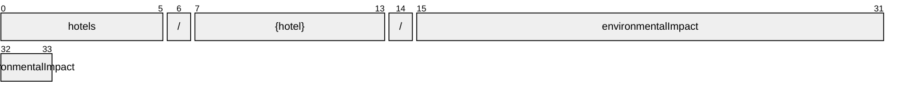

# EnvironmentalImpact

[](https://github.com/OpenTravel/OpenTravel-Specifications)
[](https://github.com/OpenTravel/OpenTravel-Specifications/tree/master/CodeLists)
[](https://aip.dev/156)
[](#methods)
[](v1/)

> [!IMPORTANT]
> Generated by `just docs` from the OpenTravel 2017B XML message suite and
> code list 2024-09-04, OpenTravel-Specifications revision 2024-11-26 (`28dcc88`).
> Do not edit by hand.

Property environmental impact and green program/ initiative information.

OTA: OTA_HotelDescriptiveContentNotifRQ/HotelDescriptiveContents/HotelDescriptiveContent/EnvironmentalImpact.

```text
hotels/{hotel}/environmentalImpact
```

## Example

A environmentalImpact as this API returns it:

```json
{
  "name": "hotels/HOT1/environmentalImpact",
  "uid": "b3f1c2de-4a5b-4c6d-8e9f-0a1b2c3d4e5f",
  "createTime": "2026-10-05T10:15:30Z",
  "updateTime": "2026-10-05T10:15:30Z"
}
```

## Resource names

Every environmentalImpact is addressed by a name that alternates collection and identifier,
per [AIP-122](https://aip.dev/122):



A singleton ([AIP-156](https://aip.dev/156)): its name ends in a literal, because a
parent has exactly one, so there is nothing to identify.

## Fields

10 fields: 5 AIP identity and lifecycle, 5 from OTA. Field numbers
8-15 are reserved, so a later identity field never renumbers an OTA one.

| Field | Type | Behavior | OTA | Description |
| --- | --- | --- | --- | --- |
| `carbon_footprint` | `EnvironmentalImpact.CarbonFootprint` | `OPTIONAL` | `EnvironmentalImpactType/CarbonFootprint` | Carbon foot print information. |
| `water` | `EnvironmentalImpact.Water` | `OPTIONAL` | `EnvironmentalImpactType/Water` | Water usage information. |
| `energy` | `EnvironmentalImpact.Energy` | `OPTIONAL` | `EnvironmentalImpactType/Energy` | Property energy and power usage information. |
| `recycling` | `EnvironmentalImpact.Recycling` | `OPTIONAL` | `EnvironmentalImpactType/Recycling` | Recycling information. |
| `general` | `EnvironmentalImpact.General` | `OPTIONAL` | `EnvironmentalImpactType/General` | Other environmental program information. |

<details>
<summary>Identity and lifecycle -- the fields every resource carries</summary>

| Field | Type | Behavior | Description |
| --- | --- | --- | --- |
| `name` | `string` | `IDENTIFIER` | Resource name, "hotels/{hotel}/environmentalImpact". |
| `uid` | `string` | `OUTPUT_ONLY` | Server-assigned unique id. |
| `etag` | `string` | `OUTPUT_ONLY` | Weak validator for optimistic concurrency, AIP-154 <https://aip.dev/154>. |
| `create_time` | `google.protobuf.Timestamp` | `OUTPUT_ONLY` | When this resource was created. |
| `update_time` | `google.protobuf.Timestamp` | `OUTPUT_ONLY` | When this resource was last modified. |

</details>

## Methods

Service `EnvironmentalImpacts`, a singleton's complete set ([AIP-156](https://aip.dev/156)):

| RPC | HTTP | Description |
| --- | --- | --- |
| `GetEnvironmentalImpact` | `GET /v1/{name=hotels/*/environmentalImpact}` | Retrieves one EnvironmentalImpact. |
| `UpdateEnvironmentalImpact` | `PATCH /v1/{environmental_impact.name=hotels/*/environmentalImpact}` | Updates a EnvironmentalImpact. Only the fields in update_mask are written. |

