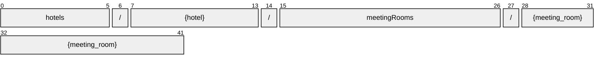

# MeetingRoom

[](https://github.com/OpenTravel/OpenTravel-Specifications)
[](https://github.com/OpenTravel/OpenTravel-Specifications/tree/master/CodeLists)
[](https://aip.dev/121)
[](#methods)
[](v1/)

> [!IMPORTANT]
> Generated by `just docs` from the OpenTravel 2017B XML message suite and
> code list 2024-09-04, OpenTravel-Specifications revision 2024-11-26 (`28dcc88`).
> Do not edit by hand.

Dedicated or non-dedicated space or area in which to hold a meeting.

OTA: OTA_HotelDescriptiveContentNotifRQ/HotelDescriptiveContents/HotelDescriptiveContent/FacilityInfo/MeetingRooms/MeetingRoom.

```text
hotels/{hotel}/meetingRooms/{meeting_room}
```

## Example

A meetingRoom as this API returns it:

```json
{
  "name": "hotels/HOT1/meetingRooms/MEE1",
  "uid": "b3f1c2de-4a5b-4c6d-8e9f-0a1b2c3d4e5f",
  "createTime": "2026-10-05T10:15:30Z",
  "updateTime": "2026-10-05T10:15:30Z",
  "irregular": true,
  "propertySystemDisplayName": "<property system display name>",
  "roomDisplayName": "<room display name>",
  "sort": 1,
  "meetingRoomCapacity": 1,
  "access": "<access>"
}
```

## Resource names

Every meetingRoom is addressed by a name that alternates collection and identifier,
per [AIP-122](https://aip.dev/122):



The last segment is OTA's `@ID`, verbatim -- OTA codes are case-sensitive,
so it is not lower-cased ([decisions](../../../../../docs/decisions.md)).

## Fields

22 fields: 7 AIP identity and lifecycle, 15 from OTA. Field numbers
8-15 are reserved, so a later identity field never renumbers an OTA one.

| Field | Type | Behavior | OTA | Description |
| --- | --- | --- | --- | --- |
| `irregular` | `bool` | `OPTIONAL` | `MeetingRoomsType/MeetingRoom/@Irregular` | This provides information as to whether the room has an irregular shape, if true the room would not be of a traditional square or rectangular style. |
| `property_system_display_name` | `string` | `OPTIONAL` | `MeetingRoomsType/MeetingRoom/@PropertySystemName` | This is the room name as it is defined by the system. |
| `room_display_name` | `string` | `OPTIONAL` | `MeetingRoomsType/MeetingRoom/@RoomName` | This is the meeting room name as provided to the guests. |
| `sort` | `int32` | `OPTIONAL` | `MeetingRoomsType/MeetingRoom/@Sort` | This is a number assigned to rooms, usually used to define the display order. |
| `meeting_room_capacity` | `int32` | `OPTIONAL` | `MeetingRoomsType/MeetingRoom/@MeetingRoomCapacity` | The total number of people permitted in the meeting room. |
| `access` | `string` | `OPTIONAL` | `MeetingRoomsType/MeetingRoom/@Access` | Used to imply the type of access to the meeting space (e.g. |
| `meeting_room_type_code` | `MeetingRoomFormatCode` | `OPTIONAL` | `MeetingRoomsType/MeetingRoom/@MeetingRoomTypeCode` | Defines the type of the meeting room being described (eg. |
| `meeting_room_level` | `string` | `OPTIONAL` | `MeetingRoomsType/MeetingRoom/@MeetingRoomLevel` | Defines the level in the facility where the meeting room is located (i.e., lobby, mezzanine, first floor, ground, outdoor, etc.) |
| `dedicated_indicator` | `bool` | `OPTIONAL` | `MeetingRoomsType/MeetingRoom/@DedicatedIndicator` | When true, the room is used for a single purpose as indicated by the MeetingRoomTypeCode attribute. |
| `featured` | `bool` | `OPTIONAL` | `MeetingRoomsType/MeetingRoom/@FeaturedInd` | If true, this is a featured meeting room for the property. |
| `codes` | `repeated MeetingRoomCodeItem` | `OPTIONAL` | `MeetingRoomsType/MeetingRoom/Codes/Code` | Codes or abbreviations for meeting rooms. |
| `dimension` | `MeetingRoom.Dimension` | `OPTIONAL` | `MeetingRoomsType/MeetingRoom/Dimension` | Dimensions of the meeting room. |
| `available_capacities` | `repeated MeetingRoomCapacity` | `OPTIONAL` | `MeetingRoomsType/MeetingRoom/AvailableCapacities/MeetingRoomCapacity` | The amount of usable meeting space available at a property. |
| `features` | `repeated Feature` | `OPTIONAL` | `MeetingRoomsType/MeetingRoom/Features/Feature` | Collection of features. |
| `multimedia_descriptions` | `MultimediaDescriptions` | `OPTIONAL` | `MeetingRoomsType/MeetingRoom/MultimediaDescriptions` | Information describing the meeting room. |

<details>
<summary>Identity and lifecycle -- the fields every resource carries</summary>

| Field | Type | Behavior | Description |
| --- | --- | --- | --- |
| `name` | `string` | `IDENTIFIER` | Resource name, "hotels/{hotel}/meetingRooms/{meeting_room}". |
| `uid` | `string` | `OUTPUT_ONLY` | Server-assigned unique id. |
| `etag` | `string` | `OUTPUT_ONLY` | Weak validator for optimistic concurrency, AIP-154 <https://aip.dev/154>. |
| `delete_time` | `google.protobuf.Timestamp` | `OUTPUT_ONLY` | When this resource was soft-deleted, unset while it is live. |
| `expire_time` | `google.protobuf.Timestamp` | `OUTPUT_ONLY` | When a soft-deleted resource is purged for good. |
| `create_time` | `google.protobuf.Timestamp` | `OUTPUT_ONLY` | When this resource was created. |
| `update_time` | `google.protobuf.Timestamp` | `OUTPUT_ONLY` | When this resource was last modified. |

</details>

## Methods

Service `MeetingRooms`, the AIP-131..135 standard methods plus [AIP-164](https://aip.dev/164) undelete:

| RPC | HTTP | Description |
| --- | --- | --- |
| `GetMeetingRoom` | `GET /v1/{name=hotels/*/meetingRooms/*}` | Retrieves one MeetingRoom. |
| `UpdateMeetingRoom` | `PATCH /v1/{meeting_room.name=hotels/*/meetingRooms/*}` | Updates a MeetingRoom. Only the fields in update_mask are written. |
| `ListMeetingRooms` | `GET /v1/{parent=hotels/*}/meetingRooms` | Lists meetingRooms, paginated per AIP-158 <https://aip.dev/158>. |
| `CreateMeetingRoom` | `POST /v1/{parent=hotels/*}/meetingRooms` | Creates a MeetingRoom. |
| `DeleteMeetingRoom` | `DELETE /v1/{name=hotels/*/meetingRooms/*}` | Soft-deletes a MeetingRoom; it is purged at expire_time unless restored. |
| `UndeleteMeetingRoom` | `POST /v1/{name=hotels/*/meetingRooms/*}:undelete` | Restores a soft-deleted MeetingRoom before it is purged. |

## Code tables

Enums numbered by their OTA code, so the wire carries exactly what OTA's XML
does ([decisions](../../../../../docs/decisions.md)):

| Table | Name | Enum | Codes |
| --- | --- | --- | --- |
| `ADT` | Additional Detail Type | `AdditionalDetailType` | 75 |
| `CFC` | Content Format Code | `ContentFormatCode` | 20 |
| `CHG` | Charge Type | `ChargeType` | 34 |
| `DIS` | Discounts Available | `DiscountsAvailable` | 40 |
| `FTT` | Fee Tax Type | `FeeTaxType` | 70 |
| `INF` | Information Type | `InfoType` | 26 |
| `MRC` | Meeting Room Code | `MeetingRoomCode` | 220 |
| `MRF` | Meeting Room Format Code | `MeetingRoomFormatCode` | 47 |
| `OTC` | Option Type Code | `OptionTypeCode` | 10 |
| `PHY` | Disability Feature Code | `DisabilityFeatureCode` | 170 |
| `PIC` | Picture Category Code | `PictureCategoryCode` | 29 |
| `PRX` | Proximity | `Proximity` | 5 |
| `SEC` | Security Feature Code | `SecurityFeatureCode` | 155 |
| `UOM` | Unit of Measure Code | `UnitOfMeasureCode` | 29 |
