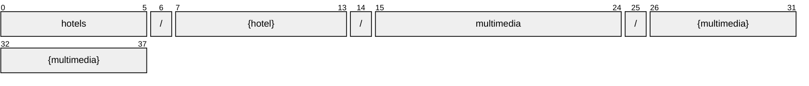

# Multimedia

[](https://github.com/OpenTravel/OpenTravel-Specifications)
[](https://github.com/OpenTravel/OpenTravel-Specifications/tree/master/CodeLists)
[](https://aip.dev/121)
[](#methods)
[](v1/)

> [!IMPORTANT]
> Generated by `just docs` from the OpenTravel 2017B XML message suite and
> code list 2024-09-04, OpenTravel-Specifications revision 2024-11-26 (`28dcc88`).
> Do not edit by hand.

A multimedia item.

OTA: OTA_HotelDescriptiveContentNotifRQ/HotelDescriptiveContents/HotelDescriptiveContent/MultimediaDescriptions/MultimediaDescription.

```text
hotels/{hotel}/multimedia/{multimedia}
```

## Example

A multimedia as this API returns it:

```json
{
  "name": "hotels/HOT1/multimedia/MUL1",
  "uid": "b3f1c2de-4a5b-4c6d-8e9f-0a1b2c3d4e5f",
  "createTime": "2026-10-05T10:15:30Z",
  "updateTime": "2026-10-05T10:15:30Z",
  "infoCode": "INFO_TYPE_DESCRIPTION",
  "additionalDetailCode": "ADDITIONAL_DETAIL_TYPE_RATE_DESCRIPTION",
  "otaUid": "<ota uid>",
  "version": "<version>"
}
```

## Resource names

Every multimedia is addressed by a name that alternates collection and identifier,
per [AIP-122](https://aip.dev/122):



The last segment is assigned by the server, or by the caller as `multimedia_id` on create.

## Fields

14 fields: 7 AIP identity and lifecycle, 7 from OTA. Field numbers
8-15 are reserved, so a later identity field never renumbers an OTA one.

| Field | Type | Behavior | OTA | Description |
| --- | --- | --- | --- | --- |
| `info_code` | `InfoType` | `OPTIONAL` | `MultimediaDescriptionType/@InfoCode` | Used to designate a particular type of description such as marketing. |
| `additional_detail_code` | `AdditionalDetailType` | `OPTIONAL` | `MultimediaDescriptionType/@AdditionalDetailCode` | Used to designate a particular type of additional information. |
| `ota_uid` | `string` | `OPTIONAL` `IMMUTABLE` | `ID_OptionalGroup/@ID` | A unique identifying value assigned by the creating system. |
| `version` | `string` | `OPTIONAL` | `MultimediaDescriptionType/@Version` | The version of the content, typically in the form of "1" or "2.3." |
| `video_items` | `VideoItems` | `OPTIONAL` | `MultimediaDescriptionType/VideoItems` | A collection of video items. |
| `image_items` | `ImageItems` | `OPTIONAL` | `MultimediaDescriptionType/ImageItems` | A collection of image items. |
| `text_items` | `TextItems` | `OPTIONAL` | `MultimediaDescriptionType/TextItems` | A collection of text items. |

<details>
<summary>Identity and lifecycle -- the fields every resource carries</summary>

| Field | Type | Behavior | Description |
| --- | --- | --- | --- |
| `name` | `string` | `IDENTIFIER` | Resource name, "hotels/{hotel}/multimedia/{multimedia}". |
| `uid` | `string` | `OUTPUT_ONLY` | Server-assigned unique id. |
| `etag` | `string` | `OUTPUT_ONLY` | Weak validator for optimistic concurrency, AIP-154 <https://aip.dev/154>. |
| `delete_time` | `google.protobuf.Timestamp` | `OUTPUT_ONLY` | When this resource was soft-deleted, unset while it is live. |
| `expire_time` | `google.protobuf.Timestamp` | `OUTPUT_ONLY` | When a soft-deleted resource is purged for good. |
| `create_time` | `google.protobuf.Timestamp` | `OUTPUT_ONLY` | When this resource was created. |
| `update_time` | `google.protobuf.Timestamp` | `OUTPUT_ONLY` | When this resource was last modified. |

</details>

## Methods

Service `MultimediaService`, the AIP-131..135 standard methods plus [AIP-164](https://aip.dev/164) undelete:

| RPC | HTTP | Description |
| --- | --- | --- |
| `GetMultimedia` | `GET /v1/{name=hotels/*/multimedia/*}` | Retrieves one Multimedia. |
| `UpdateMultimedia` | `PATCH /v1/{multimedia.name=hotels/*/multimedia/*}` | Updates a Multimedia. Only the fields in update_mask are written. |
| `ListMultimedia` | `GET /v1/{parent=hotels/*}/multimedia` | Lists multimedia, paginated per AIP-158 <https://aip.dev/158>. |
| `CreateMultimedia` | `POST /v1/{parent=hotels/*}/multimedia` | Creates a Multimedia. |
| `DeleteMultimedia` | `DELETE /v1/{name=hotels/*/multimedia/*}` | Soft-deletes a Multimedia; it is purged at expire_time unless restored. |
| `UndeleteMultimedia` | `POST /v1/{name=hotels/*/multimedia/*}:undelete` | Restores a soft-deleted Multimedia before it is purged. |

## Code tables

Enums numbered by their OTA code, so the wire carries exactly what OTA's XML
does ([decisions](../../../../../docs/decisions.md)):

| Table | Name | Enum | Codes |
| --- | --- | --- | --- |
| `ADT` | Additional Detail Type | `AdditionalDetailType` | 75 |
| `CFC` | Content Format Code | `ContentFormatCode` | 20 |
| `INF` | Information Type | `InfoType` | 26 |
| `PIC` | Picture Category Code | `PictureCategoryCode` | 29 |
| `UOM` | Unit of Measure Code | `UnitOfMeasureCode` | 29 |
