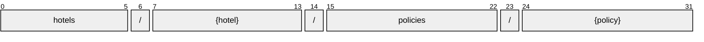

# Policy

[](https://github.com/OpenTravel/OpenTravel-Specifications)
[](https://github.com/OpenTravel/OpenTravel-Specifications/tree/master/CodeLists)
[](https://aip.dev/121)
[](#methods)
[](v1/)

> [!IMPORTANT]
> Generated by `just docs` from the OpenTravel 2017B XML message suite and
> code list 2024-09-04, OpenTravel-Specifications revision 2024-11-26 (`28dcc88`).
> Do not edit by hand.

Describes the policies of the hotel, such as the type of payments, or whether children or pets are accepted.

OTA: OTA_HotelDescriptiveContentNotifRQ/HotelDescriptiveContents/HotelDescriptiveContent/Policies/Policy.

```text
hotels/{hotel}/policies/{policy}
```

## Example

A policy as this API returns it:

```json
{
  "name": "hotels/HOT1/policies/POL1",
  "uid": "b3f1c2de-4a5b-4c6d-8e9f-0a1b2c3d4e5f",
  "createTime": "2026-10-05T10:15:30Z",
  "updateTime": "2026-10-05T10:15:30Z",
  "defaultValidBookingMinOffset": 1,
  "duration": "<duration>",
  "code": "<code>",
  "codeDetail": "<code detail>"
}
```

## Resource names

Every policy is addressed by a name that alternates collection and identifier,
per [AIP-122](https://aip.dev/122):



The last segment is assigned by the server, or by the caller as `policy_id` on create.

## Fields

26 fields: 7 AIP identity and lifecycle, 19 from OTA. Field numbers
8-15 are reserved, so a later identity field never renumbers an OTA one.

| Field | Type | Behavior | OTA | Description |
| --- | --- | --- | --- | --- |
| `default_valid_booking_min_offset` | `int32` | `OPTIONAL` | `PoliciesType/Policy/@DefaultValidBookingMinOffset` | Defines the default minimum number of days in advance that a booking must be made at this hotel. |
| `start` | `DateOrTimeOrDateTime` | `OPTIONAL` | `DateTimeSpanGroup/@Start` | The starting value of the time span. |
| `duration` | `string` | `OPTIONAL` | `DateTimeSpanGroup/@Duration` | The duration datatype represents a combination of year, month, day and time values representing a single duration of time, encoded as a single string. |
| `end` | `DateOrTimeOrDateTime` | `OPTIONAL` | `DateTimeSpanGroup/@End` | The ending value of the time span. |
| `code` | `string` | `OPTIONAL` | `PoliciesType/Policy/@Code` | The code identifying this policy. |
| `code_detail` | `string` | `OPTIONAL` | `CodeInfoGroup/@CodeDetail` | May be used to give further detail on the code. |
| `weekdays` | `repeated Weekday` | `OPTIONAL` | `DOW_PatternGroup` | The days of the week this applies on. |
| `cancel_policy` | `CancelPenalties` | `OPTIONAL` | `PoliciesType/Policy/CancelPolicy` | Defines the cancellation policy of the hotel facility. |
| `guarantee_payment_policy` | `Policy.GuaranteePaymentPolicy` | `OPTIONAL` | `PoliciesType/Policy/GuaranteePaymentPolicy` | A collection of deposit policies, guarantees policy, and/or accepted forms of payment. |
| `policy_info_codes` | `repeated Policy.PolicyInfoCode` | `OPTIONAL` | `PoliciesType/Policy/PolicyInfoCodes/PolicyInfoCode` | Detailed property policy information. |
| `checkout_charges` | `repeated Policy.CheckoutCharge` | `OPTIONAL` | `PoliciesType/Policy/CheckoutCharges/CheckoutCharge` | Checkout charges and information. |
| `policy_info` | `Policy.PolicyInfo` | `OPTIONAL` | `PoliciesType/Policy/PolicyInfo` | Basic property policy information. |
| `tax_policies` | `repeated Policy.TaxPolicy` | `OPTIONAL` | `PoliciesType/Policy/TaxPolicies/TaxPolicy` | Property tax policies. |
| `pets_policies` | `Policy.PetsPolicies` | `OPTIONAL` | `PoliciesType/Policy/PetsPolicies` | Property pet policies. |
| `stay_requirements` | `repeated Policy.StayRequirement` | `OPTIONAL` | `PoliciesType/Policy/StayRequirements/StayRequirement` | Collection of stay requirements. |
| `commission_policy` | `Policy.CommissionPolicy` | `OPTIONAL` | `PoliciesType/Policy/CommissionPolicy` | Used to define the property's high-level commission policy. |
| `fee_policies` | `repeated Fee` | `OPTIONAL` | `PoliciesType/Policy/FeePolicies/FeePolicy` | A collection of fees that may apply to a reservation. |
| `rate_policies` | `repeated Policy.RatePolicy` | `OPTIONAL` | `PoliciesType/Policy/RatePolicies/RatePolicy` | Defines the policies for various rate types (e.g. |
| `group_policies` | `repeated Policy.GroupPolicy` | `OPTIONAL` | `PoliciesType/Policy/GroupPolicies/GroupPolicy` | A collection of group policy information. |

<details>
<summary>Identity and lifecycle -- the fields every resource carries</summary>

| Field | Type | Behavior | Description |
| --- | --- | --- | --- |
| `name` | `string` | `IDENTIFIER` | Resource name, "hotels/{hotel}/policies/{policy}". |
| `uid` | `string` | `OUTPUT_ONLY` | Server-assigned unique id. |
| `etag` | `string` | `OUTPUT_ONLY` | Weak validator for optimistic concurrency, AIP-154 <https://aip.dev/154>. |
| `delete_time` | `google.protobuf.Timestamp` | `OUTPUT_ONLY` | When this resource was soft-deleted, unset while it is live. |
| `expire_time` | `google.protobuf.Timestamp` | `OUTPUT_ONLY` | When a soft-deleted resource is purged for good. |
| `create_time` | `google.protobuf.Timestamp` | `OUTPUT_ONLY` | When this resource was created. |
| `update_time` | `google.protobuf.Timestamp` | `OUTPUT_ONLY` | When this resource was last modified. |

</details>

## Methods

Service `Policies`, the AIP-131..135 standard methods plus [AIP-164](https://aip.dev/164) undelete:

| RPC | HTTP | Description |
| --- | --- | --- |
| `GetPolicy` | `GET /v1/{name=hotels/*/policies/*}` | Retrieves one Policy. |
| `UpdatePolicy` | `PATCH /v1/{policy.name=hotels/*/policies/*}` | Updates a Policy. Only the fields in update_mask are written. |
| `ListPolicies` | `GET /v1/{parent=hotels/*}/policies` | Lists policies, paginated per AIP-158 <https://aip.dev/158>. |
| `CreatePolicy` | `POST /v1/{parent=hotels/*}/policies` | Creates a Policy. |
| `DeletePolicy` | `DELETE /v1/{name=hotels/*/policies/*}` | Soft-deletes a Policy; it is purged at expire_time unless restored. |
| `UndeletePolicy` | `POST /v1/{name=hotels/*/policies/*}:undelete` | Restores a soft-deleted Policy before it is purged. |

## Code tables

Enums numbered by their OTA code, so the wire carries exactly what OTA's XML
does ([decisions](../../../../../docs/decisions.md)):

| Table | Name | Enum | Codes |
| --- | --- | --- | --- |
| `AUT` | Address Use Type | `AddressUseType` | 13 |
| `CHG` | Charge Type | `ChargeType` | 34 |
| `CLT` | Communication Location Type | `CommunicationLocationType` | 4 |
| `DOC` | Document Type | `DocumentType` | 25 |
| `EAT` | Email Address Type | `EmailAddressType` | 8 |
| `EWT` | Error Warning Type | `ErrorWarningType` | 13 |
| `FTT` | Fee Tax Type | `FeeTaxType` | 70 |
| `NAM` | Name Type | `NameType` | 4 |
| `OTC` | Option Type Code | `OptionTypeCode` | 10 |
| `PLT` | Phone Location Type | `PhoneLocationType` | 10 |
| `PMT` | Payment Type | `PaymentType` | 50 |
| `PTT` | Phone Technology Type | `PhoneTechnologyType` | 8 |
| `PUT` | Phone Use Type | `PhoneUseType` | 10 |
| `RPT` | Rate Plan Type | `RatePlanType` | 33 |
| `TVS` | Travel Sector | `TravelSector` | 11 |
| `UOM` | Unit of Measure Code | `UnitOfMeasureCode` | 29 |
