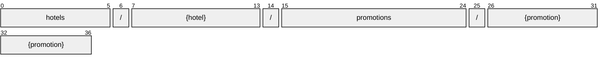

# Promotion

[](https://github.com/OpenTravel/OpenTravel-Specifications)
[](https://github.com/OpenTravel/OpenTravel-Specifications/tree/master/CodeLists)
[](https://aip.dev/121)
[](#methods)
[](v1/)

> [!IMPORTANT]
> Generated by `just docs` from the OpenTravel 2017B XML message suite and
> code list 2024-09-04, OpenTravel-Specifications revision 2024-11-26 (`28dcc88`).
> Do not edit by hand.

A hotel package or promotion.

OTA: OTA_HotelDescriptiveContentNotifRQ/HotelDescriptiveContents/HotelDescriptiveContent/Promotions/Promotion.

```text
hotels/{hotel}/promotions/{promotion}
```

## Example

A promotion as this API returns it:

```json
{
  "name": "hotels/HOT1/promotions/PRO1",
  "uid": "b3f1c2de-4a5b-4c6d-8e9f-0a1b2c3d4e5f",
  "createTime": "2026-10-05T10:15:30Z",
  "updateTime": "2026-10-05T10:15:30Z",
  "pkgOrPromotion": "PKG_OR_PROMOTION_PACKAGE",
  "type": "PACKAGE_TYPE_MOTOR_INCLUSIVE",
  "title": "<title>",
  "minLos": 1,
  "duration": "<duration>",
  "remarks": "<remarks>"
}
```

## Resource names

Every promotion is addressed by a name that alternates collection and identifier,
per [AIP-122](https://aip.dev/122):



The last segment is OTA's `@PromotionCode`, verbatim -- OTA codes are case-sensitive,
so it is not lower-cased ([decisions](../../../../../docs/decisions.md)).

## Fields

18 fields: 7 AIP identity and lifecycle, 11 from OTA. Field numbers
8-15 are reserved, so a later identity field never renumbers an OTA one.

| Field | Type | Behavior | OTA | Description |
| --- | --- | --- | --- | --- |
| `pkg_or_promotion` | `Promotion.PkgOrPromotion` | `OPTIONAL` | `HotelDescriptiveContentType/Promotions/Promotion/@PkgOrPromotion` | An indication if this is a package or promotion. |
| `type` | `PackageType` | `OPTIONAL` | `HotelDescriptiveContentType/Promotions/Promotion/@Type` | The type of the package or promotion. |
| `title` | `string` | `OPTIONAL` | `HotelDescriptiveContentType/Promotions/Promotion/@Title` | The title of the package or promotion. |
| `min_los` | `int32` | `OPTIONAL` | `HotelDescriptiveContentType/Promotions/Promotion/@MinLOS` | The minimum (day) length of stay for the promotion. |
| `weekdays` | `repeated Weekday` | `OPTIONAL` | `DOW_PatternGroup` | The days of the week this applies on. |
| `start` | `DateOrTimeOrDateTime` | `OPTIONAL` | `DateTimeSpanGroup/@Start` | The starting value of the time span. |
| `duration` | `string` | `OPTIONAL` | `DateTimeSpanGroup/@Duration` | The duration datatype represents a combination of year, month, day and time values representing a single duration of time, encoded as a single string. |
| `end` | `DateOrTimeOrDateTime` | `OPTIONAL` | `DateTimeSpanGroup/@End` | The ending value of the time span. |
| `remarks` | `string` | `OPTIONAL` | `HotelDescriptiveContentType/Promotions/Promotion/@Remarks` | Remarks regarding the promotion. |
| `sort_order` | `int32` | `OPTIONAL` | `HotelDescriptiveContentType/Promotions/Promotion/@SortOrder` | The order in which the promotion should be displayed. |
| `description` | `Description` | `OPTIONAL` | `HotelDescriptiveContentType/Promotions/Promotion/Description` | A description of a promotion. |

<details>
<summary>Identity and lifecycle -- the fields every resource carries</summary>

| Field | Type | Behavior | Description |
| --- | --- | --- | --- |
| `name` | `string` | `IDENTIFIER` | Resource name, "hotels/{hotel}/promotions/{promotion}". |
| `uid` | `string` | `OUTPUT_ONLY` | Server-assigned unique id. |
| `etag` | `string` | `OUTPUT_ONLY` | Weak validator for optimistic concurrency, AIP-154 <https://aip.dev/154>. |
| `delete_time` | `google.protobuf.Timestamp` | `OUTPUT_ONLY` | When this resource was soft-deleted, unset while it is live. |
| `expire_time` | `google.protobuf.Timestamp` | `OUTPUT_ONLY` | When a soft-deleted resource is purged for good. |
| `create_time` | `google.protobuf.Timestamp` | `OUTPUT_ONLY` | When this resource was created. |
| `update_time` | `google.protobuf.Timestamp` | `OUTPUT_ONLY` | When this resource was last modified. |

</details>

## Methods

Service `Promotions`, the AIP-131..135 standard methods plus [AIP-164](https://aip.dev/164) undelete:

| RPC | HTTP | Description |
| --- | --- | --- |
| `GetPromotion` | `GET /v1/{name=hotels/*/promotions/*}` | Retrieves one Promotion. |
| `UpdatePromotion` | `PATCH /v1/{promotion.name=hotels/*/promotions/*}` | Updates a Promotion. Only the fields in update_mask are written. |
| `ListPromotions` | `GET /v1/{parent=hotels/*}/promotions` | Lists promotions, paginated per AIP-158 <https://aip.dev/158>. |
| `CreatePromotion` | `POST /v1/{parent=hotels/*}/promotions` | Creates a Promotion. |
| `DeletePromotion` | `DELETE /v1/{name=hotels/*/promotions/*}` | Soft-deletes a Promotion; it is purged at expire_time unless restored. |
| `UndeletePromotion` | `POST /v1/{name=hotels/*/promotions/*}:undelete` | Restores a soft-deleted Promotion before it is purged. |

## Code tables

Enums numbered by their OTA code, so the wire carries exactly what OTA's XML
does ([decisions](../../../../../docs/decisions.md)):

| Table | Name | Enum | Codes |
| --- | --- | --- | --- |
| `PKG` | Package Type | `PackageType` | 9 |
