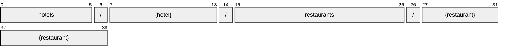

# Restaurant

[](https://github.com/OpenTravel/OpenTravel-Specifications)
[](https://github.com/OpenTravel/OpenTravel-Specifications/tree/master/CodeLists)
[](https://aip.dev/121)
[](#methods)
[](v1/)

> [!IMPORTANT]
> Generated by `just docs` from the OpenTravel 2017B XML message suite and
> code list 2024-09-04, OpenTravel-Specifications revision 2024-11-26 (`28dcc88`).
> Do not edit by hand.

Details of a specific restaurant such as type of restaurant, directions, schedules, etc.

OTA: OTA_HotelDescriptiveContentNotifRQ/HotelDescriptiveContents/HotelDescriptiveContent/FacilityInfo/Restaurants/Restaurant.

```text
hotels/{hotel}/restaurants/{restaurant}
```

## Example

A restaurant as this API returns it:

```json
{
  "name": "hotels/HOT1/restaurants/RES1",
  "uid": "b3f1c2de-4a5b-4c6d-8e9f-0a1b2c3d4e5f",
  "createTime": "2026-10-05T10:15:30Z",
  "updateTime": "2026-10-05T10:15:30Z",
  "displayName": "<display name>",
  "maxSeatingCapacity": 1,
  "maxSingleParty": 1,
  "invCode": "<inv code>",
  "offerBreakfast": true,
  "offerLunch": true
}
```

## Resource names

Every restaurant is addressed by a name that alternates collection and identifier,
per [AIP-122](https://aip.dev/122):



The last segment is OTA's `@ID`, verbatim -- OTA codes are case-sensitive,
so it is not lower-cased ([decisions](../../../../../docs/decisions.md)).

## Fields

29 fields: 7 AIP identity and lifecycle, 22 from OTA. Field numbers
8-15 are reserved, so a later identity field never renumbers an OTA one.

| Field | Type | Behavior | OTA | Description |
| --- | --- | --- | --- | --- |
| `display_name` | `string` | `OPTIONAL` | `RestaurantType/@RestaurantName` | The name of the restaurant at the facility. |
| `max_seating_capacity` | `int32` | `OPTIONAL` | `RestaurantType/@MaxSeatingCapacity` | The total seating capacity for this restaurant. |
| `max_single_party` | `int32` | `OPTIONAL` | `RestaurantType/@MaxSingleParty` | The maximum number of people that can be seated as a single party in this restaurant. |
| `inv_code` | `string` | `OPTIONAL` | `RestaurantType/@InvCode` | Identification code of the restaurant service or facility for inventory and booking purposes if the service is an inventoriable item. |
| `offer_breakfast` | `bool` | `OPTIONAL` | `RestaurantType/@OfferBreakfast` | If TRUE, breakfast is served. |
| `offer_lunch` | `bool` | `OPTIONAL` | `RestaurantType/@OfferLunch` | If TRUE, lunch is served. |
| `offer_dinner` | `bool` | `OPTIONAL` | `RestaurantType/@OfferDinner` | If TRUE, dinner is served. |
| `offer_brunch` | `bool` | `OPTIONAL` | `RestaurantType/@OfferBrunch` | If TRUE, brunch is served. |
| `proximity_code` | `string` | `OPTIONAL` | `RestaurantType/@ProximityCode` | Denotes whether a service is onsite, offsite or information is not available. |
| `sort` | `int32` | `OPTIONAL` | `RestaurantType/@Sort` | Used to define the display order. |
| `reservation_req` | `bool` | `OPTIONAL` | `RestaurantType/@ReservationReqInd` | If TRUE, a reservation must be made to dine in the restaurant. |
| `featured` | `bool` | `OPTIONAL` | `RestaurantType/@FeaturedInd` | If true, this is a featured restaurant for the property. |
| `awards_rph` | `string` | `OPTIONAL` | `RestaurantsType/Restaurant/@AwardsRPH` | A reference to an award associated with this restaurant. |
| `multimedia_descriptions` | `Restaurant.MultimediaDescriptions` | `OPTIONAL` | `RestaurantType/MultimediaDescriptions` | Multimedia information about the restaurant. |
| `relative_position` | `RelativePosition` | `OPTIONAL` | `RestaurantType/RelativePosition` | Indicates the directions to a specific restaurant. |
| `operation_schedules` | `repeated OperationSchedulesPlusChargeItem` | `OPTIONAL` | `RestaurantType/OperationSchedules/OperationSchedule` | Collection of operating times for the restaurant including detail such as season, day of week, or a combination. |
| `info_codes` | `repeated Restaurant.InfoCode` | `OPTIONAL` | `RestaurantType/InfoCodes/InfoCode` | Collection of types of restaurant. |
| `cuisine_codes` | `repeated Restaurant.CuisineCode` | `OPTIONAL` | `RestaurantType/CuisineCodes/CuisineCode` | Collection of cuisine types of restaurant. |
| `descriptive_text` | `string` | `OPTIONAL` | `RestaurantType/DescriptiveText` | Descriptive text that describes the restaurant. |
| `features` | `repeated Feature` | `OPTIONAL` | `RestaurantsType/Restaurant/Features/Feature` | Collection of features offered by a hotel. |
| `contact_infos` | `repeated ContactInfoRoot` | `OPTIONAL` | `RestaurantsType/Restaurant/ContactInfos/ContactInfo` | Collection of contact information (e.g., restaurant address, phone number). |
| `srvc_info_codes` | `repeated Restaurant.SrvcInfoCode` | `OPTIONAL` | `RestaurantsType/Restaurant/SrvcInfoCodes/SrvcInfoCode` | Collection of type of restaurant offered. |

<details>
<summary>Identity and lifecycle -- the fields every resource carries</summary>

| Field | Type | Behavior | Description |
| --- | --- | --- | --- |
| `name` | `string` | `IDENTIFIER` | Resource name, "hotels/{hotel}/restaurants/{restaurant}". |
| `uid` | `string` | `OUTPUT_ONLY` | Server-assigned unique id. |
| `etag` | `string` | `OUTPUT_ONLY` | Weak validator for optimistic concurrency, AIP-154 <https://aip.dev/154>. |
| `delete_time` | `google.protobuf.Timestamp` | `OUTPUT_ONLY` | When this resource was soft-deleted, unset while it is live. |
| `expire_time` | `google.protobuf.Timestamp` | `OUTPUT_ONLY` | When a soft-deleted resource is purged for good. |
| `create_time` | `google.protobuf.Timestamp` | `OUTPUT_ONLY` | When this resource was created. |
| `update_time` | `google.protobuf.Timestamp` | `OUTPUT_ONLY` | When this resource was last modified. |

</details>

## Methods

Service `Restaurants`, the AIP-131..135 standard methods plus [AIP-164](https://aip.dev/164) undelete:

| RPC | HTTP | Description |
| --- | --- | --- |
| `GetRestaurant` | `GET /v1/{name=hotels/*/restaurants/*}` | Retrieves one Restaurant. |
| `UpdateRestaurant` | `PATCH /v1/{restaurant.name=hotels/*/restaurants/*}` | Updates a Restaurant. Only the fields in update_mask are written. |
| `ListRestaurants` | `GET /v1/{parent=hotels/*}/restaurants` | Lists restaurants, paginated per AIP-158 <https://aip.dev/158>. |
| `CreateRestaurant` | `POST /v1/{parent=hotels/*}/restaurants` | Creates a Restaurant. |
| `DeleteRestaurant` | `DELETE /v1/{name=hotels/*/restaurants/*}` | Soft-deletes a Restaurant; it is purged at expire_time unless restored. |
| `UndeleteRestaurant` | `POST /v1/{name=hotels/*/restaurants/*}:undelete` | Restores a soft-deleted Restaurant before it is purged. |

## Code tables

Enums numbered by their OTA code, so the wire carries exactly what OTA's XML
does ([decisions](../../../../../docs/decisions.md)):

| Table | Name | Enum | Codes |
| --- | --- | --- | --- |
| `ADT` | Additional Detail Type | `AdditionalDetailType` | 75 |
| `AUT` | Address Use Type | `AddressUseType` | 13 |
| `CFC` | Content Format Code | `ContentFormatCode` | 20 |
| `CHG` | Charge Type | `ChargeType` | 34 |
| `CLT` | Communication Location Type | `CommunicationLocationType` | 4 |
| `CON` | Contact Location | `ContactLocation` | 15 |
| `CSC` | Contact Srvc Code | `ContactSrvcCode` | 30 |
| `CUI` | Main Cuisine Code | `MainCuisineCode` | 124 |
| `DOC` | Document Type | `DocumentType` | 25 |
| `EAT` | Email Address Type | `EmailAddressType` | 8 |
| `FTT` | Fee Tax Type | `FeeTaxType` | 70 |
| `INF` | Information Type | `InfoType` | 26 |
| `IPC` | Index Point Code | `IndexPointCode` | 33 |
| `NAM` | Name Type | `NameType` | 4 |
| `OPR` | Additional Operation Info | `AdditionalOperationInfo` | 6 |
| `OTC` | Option Type Code | `OptionTypeCode` | 10 |
| `PAC` | Position Accuracy | `PositionAccuracy` | 12 |
| `PHY` | Disability Feature Code | `DisabilityFeatureCode` | 170 |
| `PIC` | Picture Category Code | `PictureCategoryCode` | 29 |
| `PLT` | Phone Location Type | `PhoneLocationType` | 10 |
| `PRX` | Proximity | `Proximity` | 5 |
| `PTT` | Phone Technology Type | `PhoneTechnologyType` | 8 |
| `PUT` | Phone Use Type | `PhoneUseType` | 10 |
| `RES` | Restaurant Category Code | `RestaurantCategoryCode` | 30 |
| `RSI` | Restaurant Srvc Info | `RestaurantSrvcInfo` | 34 |
| `SEC` | Security Feature Code | `SecurityFeatureCode` | 155 |
| `TRP` | Transportation Code | `TransportationCode` | 33 |
| `TVS` | Travel Sector | `TravelSector` | 11 |
| `UOM` | Unit of Measure Code | `UnitOfMeasureCode` | 29 |
