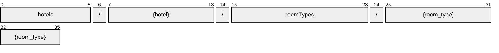

# RoomType

[](https://github.com/OpenTravel/OpenTravel-Specifications)
[](https://github.com/OpenTravel/OpenTravel-Specifications/tree/master/CodeLists)
[](https://aip.dev/121)
[](#methods)
[](v1/)

> [!IMPORTANT]
> Generated by `just docs` from the OpenTravel 2017B XML message suite and
> code list 2024-09-04, OpenTravel-Specifications revision 2024-11-26 (`28dcc88`).
> Do not edit by hand.

The accommodation occupied by a guest.

OTA: OTA_HotelDescriptiveContentNotifRQ/HotelDescriptiveContents/HotelDescriptiveContent/FacilityInfo/GuestRooms/GuestRoom.

```text
hotels/{hotel}/roomTypes/{room_type}
```

## Example

A roomType as this API returns it:

```json
{
  "name": "hotels/HOT1/roomTypes/ROO1",
  "uid": "b3f1c2de-4a5b-4c6d-8e9f-0a1b2c3d4e5f",
  "createTime": "2026-10-05T10:15:30Z",
  "updateTime": "2026-10-05T10:15:30Z",
  "codeContext": "<code context>",
  "quantity": 1,
  "uri": "<uri>",
  "displayName": "<display name>",
  "composite": true,
  "quality": "<quality>"
}
```

## Resource names

Every roomType is addressed by a name that alternates collection and identifier,
per [AIP-122](https://aip.dev/122):



The last segment is OTA's `@Code`, verbatim -- OTA codes are case-sensitive,
so it is not lower-cased ([decisions](../../../../../docs/decisions.md)).

## Fields

40 fields: 7 AIP identity and lifecycle, 33 from OTA. Field numbers
8-15 are reserved, so a later identity field never renumbers an OTA one.

| Field | Type | Behavior | OTA | Description |
| --- | --- | --- | --- | --- |
| `code_context` | `string` | `OPTIONAL` | `CodeListGroup/@CodeContext` | Identifies the source authority for the code. |
| `quantity` | `int32` | `OPTIONAL` | `CodeListGroup/@Quantity` | Used to define the quantity for an associated element or attribute. |
| `uri` | `string` | `OPTIONAL` | `CodeListGroup/@URI` | Identifies the location of the code table. |
| `display_name` | `string` | `OPTIONAL` | `FacilityInfoType/GuestRooms/GuestRoom/@RoomTypeName` | The room type name. |
| `composite` | `bool` | `OPTIONAL` | `FacilityInfoType/GuestRooms/GuestRoom/@Composite` | Indicates that the room type contains multiple rooms sold as a single unit. |
| `quality` | `string` | `OPTIONAL` | `FacilityInfoType/GuestRooms/GuestRoom/@Quality` | Indicates the quality of the room within a hotel such as an "S1K" as a superior room with one king bed. |
| `max_occupancy` | `int32` | `OPTIONAL` | `FacilityInfoType/GuestRooms/GuestRoom/@MaxOccupancy` | Maximum number of guests allowed in a room type. |
| `min_occupancy` | `int32` | `OPTIONAL` | `FacilityInfoType/GuestRooms/GuestRoom/@MinOccupancy` | Minimum number of guests allowed in a room type. |
| `max_adult_occupancy` | `int32` | `OPTIONAL` | `FacilityInfoType/GuestRooms/GuestRoom/@MaxAdultOccupancy` | Maximum number of adults allowed in a room type. |
| `nonsmoking_quantity` | `int32` | `OPTIONAL` | `FacilityInfoType/GuestRooms/GuestRoom/@NonsmokingQuantity` | This attribute is used to designate the number of non-smoking rooms by room type. |
| `ota_uid` | `string` | `OPTIONAL` `IMMUTABLE` | `ID_OptionalGroup/@ID` | A unique identifying value assigned by the creating system. |
| `max_child_occupancy` | `int32` | `OPTIONAL` | `FacilityInfoType/GuestRooms/GuestRoom/@MaxChildOccupancy` | Maximum number of children allowed in a room type. |
| `sort` | `int32` | `OPTIONAL` | `FacilityInfoType/GuestRooms/GuestRoom/@Sort` | Used to define the display order. |
| `language_code` | `string` | `OPTIONAL` | `FacilityInfoType/GuestRooms/GuestRoom/@Language` | Identifies the language in which the guest room information is being sent. |
| `type_rooms` | `repeated RoomType.TypeRoom` | `OPTIONAL` | `FacilityInfoType/GuestRooms/GuestRoom/TypeRoom` | Describes the guest room type; in composite types there can be multiple occurrences. |
| `amenities` | `repeated RoomType.Amenity` | `OPTIONAL` | `FacilityInfoType/GuestRooms/GuestRoom/Amenities/Amenity` | Collection of room amenity items available to the guest. |
| `features` | `repeated Feature` | `OPTIONAL` | `FacilityInfoType/GuestRooms/GuestRoom/Features/Feature` | Collection of features offered by a hotel. |
| `multimedia_descriptions` | `MultimediaDescriptions` | `OPTIONAL` | `FacilityInfoType/GuestRooms/GuestRoom/MultimediaDescriptions` | Multimedia information about the guest room. |
| `descriptive_text` | `string` | `OPTIONAL` | `FacilityInfoType/GuestRooms/GuestRoom/DescriptiveText` | Descriptive text that describes the guest room. |
| `rph` | `string` | `OPTIONAL` | `SellableProductsType/SellableProduct/@RPH` | This is a reference placeholder, used as an index for this sellable product. |
| `inv_code_application` | `RoomType.InvCodeApplication` | `OPTIONAL` | `InventoryGroup/@InvCodeApplication` | An enumerated type that identifies whether the InvCode is a single item which can be inventoried or a group of items which can be inventoried. |
| `inv_code` | `string` | `OPTIONAL` | `InventoryGroup/@InvCode` | Code that identifies an inventory item. |
| `inv_type` | `string` | `OPTIONAL` | `InventoryGroup/@InvType` | A value that indicates the type of inventory for which this request is made. |
| `inv_status_type` | `RoomType.InvStatusType` | `OPTIONAL` | `SellableProductsType/SellableProduct/@InvStatusType` | An enumerated type that indicates the status of the inventory item, ie: whether this notification is an initial announcement of a new inventory item, an upda... |
| `inv_grouping_code` | `string` | `OPTIONAL` | `SellableProductsType/SellableProduct/@InvGroupingCode` | The identification of the inventory grouping. |
| `order_sequence` | `int32` | `OPTIONAL` | `SellableProductsType/SellableProduct/@OrderSequence` | The order which the items should be acknowledged by the receiving entity. |
| `start` | `DateOrTimeOrDateTime` | `OPTIONAL` | `DateTimeSpanGroup/@Start` | The starting value of the time span. |
| `duration` | `string` | `OPTIONAL` | `DateTimeSpanGroup/@Duration` | The duration datatype represents a combination of year, month, day and time values representing a single duration of time, encoded as a single string. |
| `end` | `DateOrTimeOrDateTime` | `OPTIONAL` | `DateTimeSpanGroup/@End` | The ending value of the time span. |
| `destination_system_codes` | `repeated RoomType.DestinationSystemCode` | `OPTIONAL` | `SellableProductsType/SellableProduct/DestinationSystemCodes/DestinationSystemCode` | A collection of destination system codes. |
| `guest_room` | `GuestRoom` | `OPTIONAL` | `SellableProductsType/SellableProduct/GuestRoom` | Guest room information if this sellable product is a guest room. |
| `description` | `Paragraph` | `OPTIONAL` | `SellableProductsType/SellableProduct/Description` | Description of the sellable product. |
| `unique_id` | `UniqueId` | `OPTIONAL` | `SellableProductsType/SellableProduct/UniqueID` | The SellableProduct class defines the inventoriable item for this rate plan. |

<details>
<summary>Identity and lifecycle -- the fields every resource carries</summary>

| Field | Type | Behavior | Description |
| --- | --- | --- | --- |
| `name` | `string` | `IDENTIFIER` | Resource name, "hotels/{hotel}/roomTypes/{room_type}". |
| `uid` | `string` | `OUTPUT_ONLY` | Server-assigned unique id. |
| `etag` | `string` | `OUTPUT_ONLY` | Weak validator for optimistic concurrency, AIP-154 <https://aip.dev/154>. |
| `delete_time` | `google.protobuf.Timestamp` | `OUTPUT_ONLY` | When this resource was soft-deleted, unset while it is live. |
| `expire_time` | `google.protobuf.Timestamp` | `OUTPUT_ONLY` | When a soft-deleted resource is purged for good. |
| `create_time` | `google.protobuf.Timestamp` | `OUTPUT_ONLY` | When this resource was created. |
| `update_time` | `google.protobuf.Timestamp` | `OUTPUT_ONLY` | When this resource was last modified. |

</details>

## Methods

Service `RoomTypes`, the AIP-131..135 standard methods plus [AIP-164](https://aip.dev/164) undelete:

| RPC | HTTP | Description |
| --- | --- | --- |
| `GetRoomType` | `GET /v1/{name=hotels/*/roomTypes/*}` | Retrieves one RoomType. |
| `UpdateRoomType` | `PATCH /v1/{room_type.name=hotels/*/roomTypes/*}` | Updates a RoomType. Only the fields in update_mask are written. |
| `ListRoomTypes` | `GET /v1/{parent=hotels/*}/roomTypes` | Lists roomTypes, paginated per AIP-158 <https://aip.dev/158>. |
| `CreateRoomType` | `POST /v1/{parent=hotels/*}/roomTypes` | Creates a RoomType. |
| `DeleteRoomType` | `DELETE /v1/{name=hotels/*/roomTypes/*}` | Soft-deletes a RoomType; it is purged at expire_time unless restored. |
| `UndeleteRoomType` | `POST /v1/{name=hotels/*/roomTypes/*}:undelete` | Restores a soft-deleted RoomType before it is purged. |

## Code tables

Enums numbered by their OTA code, so the wire carries exactly what OTA's XML
does ([decisions](../../../../../docs/decisions.md)):

| Table | Name | Enum | Codes |
| --- | --- | --- | --- |
| `ADT` | Additional Detail Type | `AdditionalDetailType` | 75 |
| `AQC` | Age Qualifying Code | `AgeQualifyingCode` | 21 |
| `ARC` | Architectural Style Code | `ArchitecturalStyleCode` | 14 |
| `AUT` | Address Use Type | `AddressUseType` | 13 |
| `BED` | Bed Type | `BedType` | 16 |
| `CFC` | Content Format Code | `ContentFormatCode` | 20 |
| `CHG` | Charge Type | `ChargeType` | 34 |
| `CLT` | Communication Location Type | `CommunicationLocationType` | 4 |
| `CON` | Contact Location | `ContactLocation` | 15 |
| `CSC` | Contact Srvc Code | `ContactSrvcCode` | 30 |
| `DOC` | Document Type | `DocumentType` | 25 |
| `EAT` | Email Address Type | `EmailAddressType` | 8 |
| `FTT` | Fee Tax Type | `FeeTaxType` | 70 |
| `GRI` | Guest Room Info | `GuestRoomInfo` | 91 |
| `INF` | Information Type | `InfoType` | 26 |
| `NAM` | Name Type | `NameType` | 4 |
| `OPR` | Additional Operation Info | `AdditionalOperationInfo` | 6 |
| `OTC` | Option Type Code | `OptionTypeCode` | 10 |
| `PHY` | Disability Feature Code | `DisabilityFeatureCode` | 170 |
| `PIC` | Picture Category Code | `PictureCategoryCode` | 29 |
| `PLT` | Phone Location Type | `PhoneLocationType` | 10 |
| `PRX` | Proximity | `Proximity` | 5 |
| `PTT` | Phone Technology Type | `PhoneTechnologyType` | 8 |
| `PUT` | Phone Use Type | `PhoneUseType` | 10 |
| `RLT` | Room Location Type | `RoomLocationType` | 31 |
| `RMA` | Room Amenity Type | `RoomAmenityType` | 378 |
| `RVT` | Room View Type | `RoomViewType` | 45 |
| `SEC` | Security Feature Code | `SecurityFeatureCode` | 155 |
| `SEG` | Segment Category Code | `SegmentCategoryCode` | 23 |
| `TVS` | Travel Sector | `TravelSector` | 11 |
| `UIT` | Unique Id Type | `UniqueIdType` | 44 |
| `UOM` | Unit of Measure Code | `UnitOfMeasureCode` | 29 |
