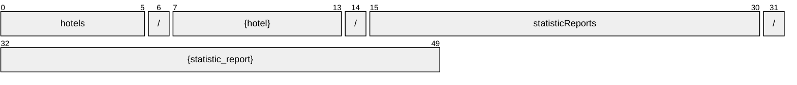

# StatisticReport

[](https://github.com/OpenTravel/OpenTravel-Specifications)
[](https://github.com/OpenTravel/OpenTravel-Specifications/tree/master/CodeLists)
[](https://aip.dev/121)
[](#methods)
[](v1/)

> [!IMPORTANT]
> Generated by `just docs` from the OpenTravel 2017B XML message suite and
> code list 2024-09-04, OpenTravel-Specifications revision 2024-11-26 (`28dcc88`).
> Do not edit by hand.

Used to define the report fiscal date, report code, and the hotel(s) for which data is being reported.

OTA: OTA_HotelStatsNotifRQ/Statistics/Statistic.

```text
hotels/{hotel}/statisticReports/{statistic_report}
```

## Example

A statisticReport as this API returns it:

```json
{
  "name": "hotels/HOT1/statisticReports/STA1",
  "uid": "b3f1c2de-4a5b-4c6d-8e9f-0a1b2c3d4e5f",
  "createTime": "2026-10-05T10:15:30Z",
  "updateTime": "2026-10-05T10:15:30Z",
  "reportCode": "<report code>"
}
```

## Resource names

Every statisticReport is addressed by a name that alternates collection and identifier,
per [AIP-122](https://aip.dev/122):



The last segment is assigned by the server, or by the caller as `statistic_report_id` on create.

## Fields

10 fields: 7 AIP identity and lifecycle, 3 from OTA. Field numbers
8-15 are reserved, so a later identity field never renumbers an OTA one.

| Field | Type | Behavior | OTA | Description |
| --- | --- | --- | --- | --- |
| `fiscal` | `DateOrDateTime` | `OPTIONAL` | `StatisticReportGroup/@FiscalDate` | Hotel fiscal date for statistics. |
| `report_code` | `string` | `OPTIONAL` | `StatisticReportGroup/@ReportCode` | Identifies the type of statistics collected. |
| `statistic_application_sets` | `repeated StatisticApplicationSet` | `REQUIRED` | `StatisticType/StatisticApplicationSets/StatisticApplicationSet` | Collection of StatisticApplicationSet Elements. |

<details>
<summary>Identity and lifecycle -- the fields every resource carries</summary>

| Field | Type | Behavior | Description |
| --- | --- | --- | --- |
| `name` | `string` | `IDENTIFIER` | Resource name, "hotels/{hotel}/statisticReports/{statistic_report}". |
| `uid` | `string` | `OUTPUT_ONLY` | Server-assigned unique id. |
| `etag` | `string` | `OUTPUT_ONLY` | Weak validator for optimistic concurrency, AIP-154 <https://aip.dev/154>. |
| `delete_time` | `google.protobuf.Timestamp` | `OUTPUT_ONLY` | When this resource was soft-deleted, unset while it is live. |
| `expire_time` | `google.protobuf.Timestamp` | `OUTPUT_ONLY` | When a soft-deleted resource is purged for good. |
| `create_time` | `google.protobuf.Timestamp` | `OUTPUT_ONLY` | When this resource was created. |
| `update_time` | `google.protobuf.Timestamp` | `OUTPUT_ONLY` | When this resource was last modified. |

</details>

## Methods

Service `StatisticReports`, the AIP-131..135 standard methods plus [AIP-164](https://aip.dev/164) undelete:

| RPC | HTTP | Description |
| --- | --- | --- |
| `GetStatisticReport` | `GET /v1/{name=hotels/*/statisticReports/*}` | Retrieves one StatisticReport. |
| `UpdateStatisticReport` | `PATCH /v1/{statistic_report.name=hotels/*/statisticReports/*}` | Updates a StatisticReport. Only the fields in update_mask are written. |
| `ListStatisticReports` | `GET /v1/{parent=hotels/*}/statisticReports` | Lists statisticReports, paginated per AIP-158 <https://aip.dev/158>. |
| `CreateStatisticReport` | `POST /v1/{parent=hotels/*}/statisticReports` | Creates a StatisticReport. |
| `DeleteStatisticReport` | `DELETE /v1/{name=hotels/*/statisticReports/*}` | Soft-deletes a StatisticReport; it is purged at expire_time unless restored. |
| `UndeleteStatisticReport` | `POST /v1/{name=hotels/*/statisticReports/*}:undelete` | Restores a soft-deleted StatisticReport before it is purged. |

## Code tables

Enums numbered by their OTA code, so the wire carries exactly what OTA's XML
does ([decisions](../../../../../docs/decisions.md)):

| Table | Name | Enum | Codes |
| --- | --- | --- | --- |
| `CNT` | Count Category | `CountCategory` | 22 |
| `RCC` | Revenue Category Code | `RevenueCategoryCode` | 36 |
