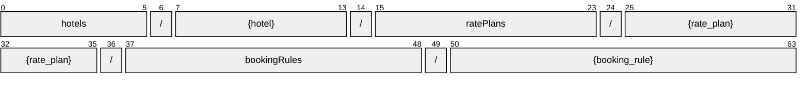

# BookingRule

[](https://github.com/OpenTravel/OpenTravel-Specifications)
[](https://github.com/OpenTravel/OpenTravel-Specifications/tree/master/CodeLists)
[](https://aip.dev/121)
[](#methods)
[](v1/)

> [!IMPORTANT]
> Generated by `just docs` from the OpenTravel 2017B XML message suite and
> code list 2024-09-04, OpenTravel-Specifications revision 2024-11-26 (`28dcc88`).
> Do not edit by hand.

Container for the collection of Booking Rules for a given hotel or chain.

OTA: OTA_HotelBookingRuleNotifRQ/RuleMessages/RuleMessage.

```text
hotels/{hotel}/ratePlans/{rate_plan}/bookingRules/{booking_rule}
```

## Example

A bookingRule as this API returns it:

```json
{
  "name": "hotels/HOT1/ratePlans/RAT1/bookingRules/BOO1",
  "uid": "b3f1c2de-4a5b-4c6d-8e9f-0a1b2c3d4e5f",
  "createTime": "2026-10-05T10:15:30Z",
  "updateTime": "2026-10-05T10:15:30Z"
}
```

## Resource names

Every bookingRule is addressed by a name that alternates collection and identifier,
per [AIP-122](https://aip.dev/122):



The last segment is assigned by the server, or by the caller as `booking_rule_id` on create.

## Fields

9 fields: 7 AIP identity and lifecycle, 2 from OTA. Field numbers
8-15 are reserved, so a later identity field never renumbers an OTA one.

| Field | Type | Behavior | OTA | Description |
| --- | --- | --- | --- | --- |
| `booking_rules` | `repeated BookingRulesItem` | `OPTIONAL` | `OTA_HotelBookingRuleNotifRQ/RuleMessages/RuleMessage/BookingRules/BookingRule` | Container for the collection of Booking Rules which apply for the information indicated in the StatusApplicationControl element. |
| `unique_id` | `UniqueId` | `OPTIONAL` | `OTA_HotelBookingRuleNotifRQ/RuleMessages/RuleMessage/UniqueID` | The unique identifier element allows the trading partners to uniquely identify each BookingRuleMessage, for tracing of transactions. |

<details>
<summary>Identity and lifecycle -- the fields every resource carries</summary>

| Field | Type | Behavior | Description |
| --- | --- | --- | --- |
| `name` | `string` | `IDENTIFIER` | Resource name, "hotels/{hotel}/ratePlans/{rate_plan}/bookingRules/{booking_rule}". |
| `uid` | `string` | `OUTPUT_ONLY` | Server-assigned unique id. |
| `etag` | `string` | `OUTPUT_ONLY` | Weak validator for optimistic concurrency, AIP-154 <https://aip.dev/154>. |
| `delete_time` | `google.protobuf.Timestamp` | `OUTPUT_ONLY` | When this resource was soft-deleted, unset while it is live. |
| `expire_time` | `google.protobuf.Timestamp` | `OUTPUT_ONLY` | When a soft-deleted resource is purged for good. |
| `create_time` | `google.protobuf.Timestamp` | `OUTPUT_ONLY` | When this resource was created. |
| `update_time` | `google.protobuf.Timestamp` | `OUTPUT_ONLY` | When this resource was last modified. |

</details>

## Methods

Service `BookingRules`, the AIP-131..135 standard methods plus [AIP-164](https://aip.dev/164) undelete:

| RPC | HTTP | Description |
| --- | --- | --- |
| `GetBookingRule` | `GET /v1/{name=hotels/*/ratePlans/*/bookingRules/*}` | Retrieves one BookingRule. |
| `UpdateBookingRule` | `PATCH /v1/{booking_rule.name=hotels/*/ratePlans/*/bookingRules/*}` | Updates a BookingRule. Only the fields in update_mask are written. |
| `ListBookingRules` | `GET /v1/{parent=hotels/*/ratePlans/*}/bookingRules` | Lists bookingRules, paginated per AIP-158 <https://aip.dev/158>. |
| `CreateBookingRule` | `POST /v1/{parent=hotels/*/ratePlans/*}/bookingRules` | Creates a BookingRule. |
| `DeleteBookingRule` | `DELETE /v1/{name=hotels/*/ratePlans/*/bookingRules/*}` | Soft-deletes a BookingRule; it is purged at expire_time unless restored. |
| `UndeleteBookingRule` | `POST /v1/{name=hotels/*/ratePlans/*/bookingRules/*}:undelete` | Restores a soft-deleted BookingRule before it is purged. |
| `BatchUpdateBookingRules` | `POST /v1/{parent=hotels/*/ratePlans/*}/bookingRules:batchUpdate` | Sets booking rules for many days at once. OTA_HotelBookingRuleNotifRQ. |

## Code tables

Enums numbered by their OTA code, so the wire carries exactly what OTA's XML
does ([decisions](../../../../../docs/decisions.md)):

| Table | Name | Enum | Codes |
| --- | --- | --- | --- |
| `AUT` | Address Use Type | `AddressUseType` | 13 |
| `CHG` | Charge Type | `ChargeType` | 34 |
| `CLT` | Communication Location Type | `CommunicationLocationType` | 4 |
| `DOC` | Document Type | `DocumentType` | 25 |
| `EAT` | Email Address Type | `EmailAddressType` | 8 |
| `EWT` | Error Warning Type | `ErrorWarningType` | 13 |
| `FTT` | Fee Tax Type | `FeeTaxType` | 70 |
| `NAM` | Name Type | `NameType` | 4 |
| `OTC` | Option Type Code | `OptionTypeCode` | 10 |
| `PLT` | Phone Location Type | `PhoneLocationType` | 10 |
| `PMT` | Payment Type | `PaymentType` | 50 |
| `PRT` | Profile Type | `ProfileType` | 23 |
| `PTT` | Phone Technology Type | `PhoneTechnologyType` | 8 |
| `PUT` | Phone Use Type | `PhoneUseType` | 10 |
| `TVS` | Travel Sector | `TravelSector` | 11 |
| `UIT` | Unique Id Type | `UniqueIdType` | 44 |
