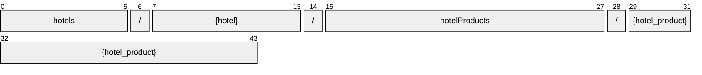

# HotelProduct

[](https://github.com/OpenTravel/OpenTravel-Specifications)
[](https://github.com/OpenTravel/OpenTravel-Specifications/tree/master/CodeLists)
[](https://aip.dev/121)
[](#methods)
[](v1/)

> [!IMPORTANT]
> Generated by `just docs` from the OpenTravel 2017B XML message suite and
> code list 2024-09-04, OpenTravel-Specifications revision 2024-11-26 (`28dcc88`).
> Do not edit by hand.

Specifies product information for a hotel. A product may be a room type, a rate plan, a room type rate plan combination or hotel policy information. This may be used for sending products at multiple hotels or multiple products at a single hotel.

OTA: OTA_HotelProductNotifRQ/HotelProducts/HotelProduct.

```text
hotels/{hotel}/hotelProducts/{hotel_product}
```

## Example

A hotelProduct as this API returns it:

```json
{
  "name": "hotels/HOT1/hotelProducts/HOT1",
  "uid": "b3f1c2de-4a5b-4c6d-8e9f-0a1b2c3d4e5f",
  "createTime": "2026-10-05T10:15:30Z",
  "updateTime": "2026-10-05T10:15:30Z",
  "productStatusType": "PRODUCT_STATUS_TYPE_INITIAL"
}
```

## Resource names

Every hotelProduct is addressed by a name that alternates collection and identifier,
per [AIP-122](https://aip.dev/122):



The last segment is assigned by the server, or by the caller as `hotel_product_id` on create.

## Fields

19 fields: 7 AIP identity and lifecycle, 12 from OTA. Field numbers
8-15 are reserved, so a later identity field never renumbers an OTA one.

| Field | Type | Behavior | OTA | Description |
| --- | --- | --- | --- | --- |
| `product_status_type` | `HotelProduct.ProductStatusType` | `OPTIONAL` | `HotelProductType/@ProductStatusType` | Identifies the status of the product ( i.e. |
| `unique_id` | `UniqueId` | `OPTIONAL` | `HotelProductType/UniqueID` | The unique identifier element allows the trading partners to uniquely identify each HotelProduct for tracing of transactions. |
| `hotel_refs` | `repeated HotelProduct.HotelRef` | `OPTIONAL` | `HotelProductType/HotelRefs/HotelRef` | A collection of HotelRef elements. |
| `room_types` | `repeated HotelProduct.RoomType` | `OPTIONAL` | `HotelProductType/RoomTypes/RoomType` | A collection of room types. |
| `rate_plans` | `repeated HotelProduct.RatePlan` | `OPTIONAL` | `HotelProductType/RatePlans/RatePlan` | A collection of rate plans. |
| `value_add_inclusions` | `HotelProduct.ValueAddInclusions` | `OPTIONAL` | `HotelProductType/ValueAddInclusions` | Identifies items that are included with this product that add value or differentiate this product from other products at no additional charge (i.e. |
| `policy_info` | `HotelProduct.PolicyInfo` | `OPTIONAL` | `HotelProductType/PolicyInfo` | Policy Information for this product. |
| `contacts` | `repeated ContactPerson` | `OPTIONAL` | `HotelProductType/Contacts/Contact` | A collection of contacts. |
| `taxes` | `repeated Tax` | `OPTIONAL` | `HotelProductType/Taxes/Tax` | Taxes that apply to the product. |
| `fees` | `repeated Fee` | `OPTIONAL` | `HotelProductType/Fees/Fee` | Fees that apply to the product. |
| `descriptions` | `repeated HotelProduct.Description` | `OPTIONAL` | `HotelProductType/Descriptions/Description` | A Container for the repeating description element. |
| `additional_guest_amounts` | `repeated HotelProduct.AdditionalGuestAmount` | `OPTIONAL` | `HotelProductType/AdditionalGuestAmounts/AdditionalGuestAmount` | A collection of charges related to additional guests. |

<details>
<summary>Identity and lifecycle -- the fields every resource carries</summary>

| Field | Type | Behavior | Description |
| --- | --- | --- | --- |
| `name` | `string` | `IDENTIFIER` | Resource name, "hotels/{hotel}/hotelProducts/{hotel_product}". |
| `uid` | `string` | `OUTPUT_ONLY` | Server-assigned unique id. |
| `etag` | `string` | `OUTPUT_ONLY` | Weak validator for optimistic concurrency, AIP-154 <https://aip.dev/154>. |
| `delete_time` | `google.protobuf.Timestamp` | `OUTPUT_ONLY` | When this resource was soft-deleted, unset while it is live. |
| `expire_time` | `google.protobuf.Timestamp` | `OUTPUT_ONLY` | When a soft-deleted resource is purged for good. |
| `create_time` | `google.protobuf.Timestamp` | `OUTPUT_ONLY` | When this resource was created. |
| `update_time` | `google.protobuf.Timestamp` | `OUTPUT_ONLY` | When this resource was last modified. |

</details>

## Methods

Service `HotelProducts`, the AIP-131..135 standard methods plus [AIP-164](https://aip.dev/164) undelete:

| RPC | HTTP | Description |
| --- | --- | --- |
| `GetHotelProduct` | `GET /v1/{name=hotels/*/hotelProducts/*}` | Retrieves one HotelProduct. |
| `UpdateHotelProduct` | `PATCH /v1/{hotel_product.name=hotels/*/hotelProducts/*}` | Updates a HotelProduct. Only the fields in update_mask are written. |
| `ListHotelProducts` | `GET /v1/{parent=hotels/*}/hotelProducts` | Lists hotelProducts, paginated per AIP-158 <https://aip.dev/158>. |
| `CreateHotelProduct` | `POST /v1/{parent=hotels/*}/hotelProducts` | Creates a HotelProduct. |
| `DeleteHotelProduct` | `DELETE /v1/{name=hotels/*/hotelProducts/*}` | Soft-deletes a HotelProduct; it is purged at expire_time unless restored. |
| `UndeleteHotelProduct` | `POST /v1/{name=hotels/*/hotelProducts/*}:undelete` | Restores a soft-deleted HotelProduct before it is purged. |

## Code tables

Enums numbered by their OTA code, so the wire carries exactly what OTA's XML
does ([decisions](../../../../../docs/decisions.md)):

| Table | Name | Enum | Codes |
| --- | --- | --- | --- |
| `ADT` | Additional Detail Type | `AdditionalDetailType` | 75 |
| `AQC` | Age Qualifying Code | `AgeQualifyingCode` | 21 |
| `AUT` | Address Use Type | `AddressUseType` | 13 |
| `BED` | Bed Type | `BedType` | 16 |
| `CHG` | Charge Type | `ChargeType` | 34 |
| `CLT` | Communication Location Type | `CommunicationLocationType` | 4 |
| `DOC` | Document Type | `DocumentType` | 25 |
| `DTB` | Distribution Type | `DistributionType` | 16 |
| `EAT` | Email Address Type | `EmailAddressType` | 8 |
| `EMP` | Employee Status | `EmployeeStatusCode` | 4 |
| `EWT` | Error Warning Type | `ErrorWarningType` | 13 |
| `FTT` | Fee Tax Type | `FeeTaxType` | 70 |
| `GRI` | Guest Room Info | `GuestRoomInfo` | 91 |
| `HAC` | Hotel Amenity Code | `HotelAmenityCode` | 504 |
| `MPT` | Meal Plan Type | `MealPlanType` | 27 |
| `NAM` | Name Type | `NameType` | 4 |
| `PLT` | Phone Location Type | `PhoneLocationType` | 10 |
| `PMT` | Payment Type | `PaymentType` | 50 |
| `PTT` | Phone Technology Type | `PhoneTechnologyType` | 8 |
| `PUT` | Phone Use Type | `PhoneUseType` | 10 |
| `RLT` | Room Location Type | `RoomLocationType` | 31 |
| `RMA` | Room Amenity Type | `RoomAmenityType` | 378 |
| `RPT` | Rate Plan Type | `RatePlanType` | 33 |
| `RVT` | Room View Type | `RoomViewType` | 45 |
| `TVS` | Travel Sector | `TravelSector` | 11 |
| `UIT` | Unique Id Type | `UniqueIdType` | 44 |
