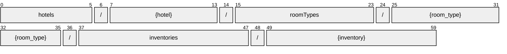

# Inventory

[](https://github.com/OpenTravel/OpenTravel-Specifications)
[](https://github.com/OpenTravel/OpenTravel-Specifications/tree/master/CodeLists)
[](https://aip.dev/121)
[](#methods)
[](v1/)

> [!IMPORTANT]
> Generated by `just docs` from the OpenTravel 2017B XML message suite and
> code list 2024-09-04, OpenTravel-Specifications revision 2024-11-26 (`28dcc88`).
> Do not edit by hand.

This is the inventory information for a given rate plan, room type, date, etc.

OTA: OTA_HotelInvCountNotifRQ/Inventories/Inventory.

```text
hotels/{hotel}/roomTypes/{room_type}/inventories/{inventory}
```

## Example

A inventory as this API returns it:

```json
{
  "name": "hotels/HOT1/roomTypes/ROO1/inventories/INV1",
  "uid": "b3f1c2de-4a5b-4c6d-8e9f-0a1b2c3d4e5f",
  "createTime": "2026-10-05T10:15:30Z",
  "updateTime": "2026-10-05T10:15:30Z"
}
```

## Resource names

Every inventory is addressed by a name that alternates collection and identifier,
per [AIP-122](https://aip.dev/122):



The last segment is assigned by the server, or by the caller as `inventory_id` on create.

## Fields

10 fields: 7 AIP identity and lifecycle, 3 from OTA. Field numbers
8-15 are reserved, so a later identity field never renumbers an OTA one.

| Field | Type | Behavior | OTA | Description |
| --- | --- | --- | --- | --- |
| `inv_counts` | `repeated Inventory.InvCount` | `OPTIONAL` | `BaseInvCountType/InvCounts/InvCount` | A collection of inventory counts. |
| `off_sell` | `Inventory.OffSell` | `OPTIONAL` | `BaseInvCountType/OffSell` | Communicates additional information about inventory that is not available for sale. |
| `unique_id` | `UniqueId` | `OPTIONAL` | `BaseInvCountType/UniqueID` | The unique identifier element allows the trading partners to uniquely identify each InvCountNotifRQ, (i.e. |

<details>
<summary>Identity and lifecycle -- the fields every resource carries</summary>

| Field | Type | Behavior | Description |
| --- | --- | --- | --- |
| `name` | `string` | `IDENTIFIER` | Resource name, "hotels/{hotel}/roomTypes/{room_type}/inventories/{inventory}". |
| `uid` | `string` | `OUTPUT_ONLY` | Server-assigned unique id. |
| `etag` | `string` | `OUTPUT_ONLY` | Weak validator for optimistic concurrency, AIP-154 <https://aip.dev/154>. |
| `delete_time` | `google.protobuf.Timestamp` | `OUTPUT_ONLY` | When this resource was soft-deleted, unset while it is live. |
| `expire_time` | `google.protobuf.Timestamp` | `OUTPUT_ONLY` | When a soft-deleted resource is purged for good. |
| `create_time` | `google.protobuf.Timestamp` | `OUTPUT_ONLY` | When this resource was created. |
| `update_time` | `google.protobuf.Timestamp` | `OUTPUT_ONLY` | When this resource was last modified. |

</details>

## Methods

Service `Inventories`, the AIP-131..135 standard methods plus [AIP-164](https://aip.dev/164) undelete:

| RPC | HTTP | Description |
| --- | --- | --- |
| `GetInventory` | `GET /v1/{name=hotels/*/roomTypes/*/inventories/*}` | Retrieves one Inventory. |
| `UpdateInventory` | `PATCH /v1/{inventory.name=hotels/*/roomTypes/*/inventories/*}` | Updates a Inventory. Only the fields in update_mask are written. |
| `ListInventories` | `GET /v1/{parent=hotels/*/roomTypes/*}/inventories` | Lists inventories, paginated per AIP-158 <https://aip.dev/158>. |
| `CreateInventory` | `POST /v1/{parent=hotels/*/roomTypes/*}/inventories` | Creates a Inventory. |
| `DeleteInventory` | `DELETE /v1/{name=hotels/*/roomTypes/*/inventories/*}` | Soft-deletes a Inventory; it is purged at expire_time unless restored. |
| `UndeleteInventory` | `POST /v1/{name=hotels/*/roomTypes/*/inventories/*}:undelete` | Restores a soft-deleted Inventory before it is purged. |
| `BatchUpdateInventories` | `POST /v1/{parent=hotels/*/roomTypes/*}/inventories:batchUpdate` | Sets inventory counts for many days at once. OTA_HotelInvCountNotifRQ, its ranges expanded to days. |
| `AdjustInventories` | `POST /v1/{parent=hotels/*/roomTypes/*}/inventories:adjust` | Adjusts inventory by the reservations that consume it. OTA_HotelInvAdjustRQ. |
| `SyncInventories` | `POST /v1/{parent=hotels/*/roomTypes/*}/inventories:sync` | Reconciles inventory with another system's view of it. OTA_HotelInvSyncRQ. |

## Code tables

Enums numbered by their OTA code, so the wire carries exactly what OTA's XML
does ([decisions](../../../../../docs/decisions.md)):

| Table | Name | Enum | Codes |
| --- | --- | --- | --- |
| `INV` | Inventory Count Type | `InventoryCountType` | 21 |
| `TVS` | Travel Sector | `TravelSector` | 11 |
| `UIT` | Unique Id Type | `UniqueIdType` | 44 |
