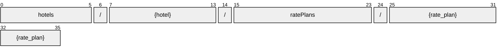

# RatePlan

[](https://github.com/OpenTravel/OpenTravel-Specifications)
[](https://github.com/OpenTravel/OpenTravel-Specifications/tree/master/CodeLists)
[](https://aip.dev/121)
[](#methods)
[](v1/)

> [!IMPORTANT]
> Generated by `just docs` from the OpenTravel 2017B XML message suite and
> code list 2024-09-04, OpenTravel-Specifications revision 2024-11-26 (`28dcc88`).
> Do not edit by hand.

An individual rate plan.

OTA: OTA_HotelRatePlanNotifRQ/RatePlans/RatePlan.

```text
hotels/{hotel}/ratePlans/{rate_plan}
```

## Example

A ratePlan as this API returns it:

```json
{
  "name": "hotels/HOT1/ratePlans/RAT1",
  "uid": "b3f1c2de-4a5b-4c6d-8e9f-0a1b2c3d4e5f",
  "createTime": "2026-10-05T10:15:30Z",
  "updateTime": "2026-10-05T10:15:30Z",
  "duration": "<duration>",
  "ratePlanType": "RATE_PLAN_TYPE_ASSOCIATION",
  "ratePlanId": "<rate plan id>",
  "ratePlanQualifier": true,
  "promotionCode": "<promotion code>",
  "ratePlanCategory": "<rate plan category>"
}
```

## Resource names

Every ratePlan is addressed by a name that alternates collection and identifier,
per [AIP-122](https://aip.dev/122):



The last segment is OTA's `@RatePlanCode`, verbatim -- OTA codes are case-sensitive,
so it is not lower-cased ([decisions](../../../../../docs/decisions.md)).

## Fields

50 fields: 7 AIP identity and lifecycle, 43 from OTA. Field numbers
8-15 are reserved, so a later identity field never renumbers an OTA one.

| Field | Type | Behavior | OTA | Description |
| --- | --- | --- | --- | --- |
| `start` | `DateOrTimeOrDateTime` | `OPTIONAL` | `DateTimeSpanGroup/@Start` | The starting value of the time span. |
| `duration` | `string` | `OPTIONAL` | `DateTimeSpanGroup/@Duration` | The duration datatype represents a combination of year, month, day and time values representing a single duration of time, encoded as a single string. |
| `end` | `DateOrTimeOrDateTime` | `OPTIONAL` | `DateTimeSpanGroup/@End` | The ending value of the time span. |
| `rate_plan_type` | `RatePlanType` | `OPTIONAL` | `RatePlanGroup/@RatePlanType` | An enumerated type that allows the query to specify a rate category type, and provides major categories for comparison across brands. |
| `rate_plan_id` | `string` | `OPTIONAL` | `RatePlanGroup/@RatePlanID` | A text field used to indicate a special ID code that is associated with the rate and is essential in the reservation request in order to obtain the rate. |
| `rate_plan_qualifier` | `bool` | `OPTIONAL` | `RatePlanGroup/@RatePlanQualifier` | The Rate Plan Qualifier is used to control the sort order of RatePlans. |
| `promotion_code` | `string` | `OPTIONAL` | `RatePlanGroup/@PromotionCode` | Promotion code is the identifier used by the host to link directly with a specific named advertising campaign. |
| `promotion_vendor_codes` | `repeated string` | `OPTIONAL` | `RatePlanGroup/@PromotionVendorCode` | List of the vendor codes associated with a promotion. |
| `rate_plan_category` | `string` | `OPTIONAL` | `RatePlanGroup/@RatePlanCategory` | Hotel systems often group multiple rate plans into a single category. |
| `rate_plan_code_type` | `RatePlan.RatePlanCodeType` | `OPTIONAL` | `RatePlanCodeTypeGroup/@RatePlanCodeType` | An enumerated list that defines whether the RatePlanCodeType does not apply, applies to a rate plan code or applies to a rate plan grouping code. |
| `rate_plan_status_type` | `RatePlan.RatePlanStatusType` | `OPTIONAL` | `HotelRatePlanType/@RatePlanStatusType` | An enumerated type that indicates the status of the rate plan, ie: whether this notification is an initial announcement of a new rate plan, an update of an a... |
| `rate_plan_notif_scope_type` | `RatePlan.RatePlanNotifScopeType` | `OPTIONAL` | `HotelRatePlanType/@RatePlanNotifScopeType` | An enumerated type that indicates the scope of the rate plan notification. |
| `commissionable` | `bool` | `OPTIONAL` | `HotelRatePlanType/@IsCommissionable` | Is commissionable. |
| `rate_return` | `bool` | `OPTIONAL` | `HotelRatePlanType/@RateReturn` | Rate return. |
| `yieldable_indicator` | `bool` | `OPTIONAL` | `HotelRatePlanType/@YieldableIndicator` | Used to indicate the rate plan is subject to yield management logic. |
| `market_code` | `string` | `OPTIONAL` | `HotelRatePlanType/@MarketCode` | The code that relates to the market being sold to (e.g., the corporate market, packages). |
| `yield_delta_amount` | `Money` | `OPTIONAL` | `HotelRatePlanType/@YieldDeltaAmount` | The amount to be added or subtracted from the rate. |
| `inventory_allocated` | `bool` | `OPTIONAL` | `HotelRatePlanType/@InventoryAllocatedInd` | When true, indicates the inventory associated with the rate plan is removed from the house inventory. |
| `restricted_display_indicator` | `bool` | `OPTIONAL` | `HotelRatePlanType/@RestrictedDisplayIndicator` | When true, used to indicate the rate should not be displayed. |
| `earliest_start_indicator` | `bool` | `OPTIONAL` | `HotelRatePlanType/@EarliestStartIndicator` | This is used in conjunction with the Start attribute. |
| `latest_end_indicator` | `bool` | `OPTIONAL` | `HotelRatePlanType/@LatestEndIndicator` | This is used in conjunction with the End attribute. |
| `extra_night_rate_plan_code` | `string` | `OPTIONAL` | `HotelRatePlanType/@ExtraNightRatePlanCode` | Used to indicate what rate plan is used for shoulder night(s) booked in addition to the base nights. |
| `base_rate_plan_code` | `string` | `OPTIONAL` | `DerivedRatePlanGroup/@BaseRatePlanCode` | The rate plan this rate plan is derived from. |
| `adjusted_amount` | `Money` | `OPTIONAL` | `DerivedRatePlanGroup/@AdjustedAmount` | The amount which should be added to the base rate plan to determine the price of this derived rate plan. |
| `adjusted_percentage` | `Decimal` | `OPTIONAL` | `DerivedRatePlanGroup/@AdjustedPercentage` | The percentage off the base rate plan amount used to determine the price of this derived rate plan. |
| `floor_amount` | `Money` | `OPTIONAL` | `DerivedRatePlanGroup/@FloorAmount` | The lowest amount for which this derived rate plan should be sold. |
| `ceiling_amount` | `Money` | `OPTIONAL` | `DerivedRatePlanGroup/@CeilingAmount` | The highest amount for which this derived rate plan should be sold. |
| `adjust_up_indicator` | `bool` | `OPTIONAL` | `DerivedRatePlanGroup/@AdjustUpIndicator` | When true, the adjusted amount or adjusted percentage is added to the amount specified for the base rate plan to determine the derived rate amount. |
| `charge_type_code` | `ChargeType` | `OPTIONAL` | `HotelRatePlanType/@ChargeTypeCode` | Describes how the charge is applied. |
| `accrual_indicator` | `bool` | `OPTIONAL` | `HotelRatePlanType/@AccrualIndicator` | Used to indicate the rate plan is eligible for loyalty points accrual. |
| `auto_enrollment_indicator` | `bool` | `OPTIONAL` | `HotelRatePlanType/@AutoEnrollmentIndicator` | Used to indicate that booking the rate plan will result in auto enrollment in loyalty program. |
| `destination_systems_code` | `repeated RatePlan.DestinationSystemCode` | `OPTIONAL` | `HotelRatePlanType/DestinationSystemsCode/DestinationSystemCode` | A collection of destination system codes. |
| `booking_rules` | `RatePlan.BookingRules` | `OPTIONAL` | `HotelRatePlanType/BookingRules` | A collection of booking rules. |
| `rates` | `repeated RatePlan.Rate` | `OPTIONAL` | `HotelRatePlanType/Rates/Rate` | A collection of Rates. |
| `supplements` | `repeated RatePlan.Supplement` | `OPTIONAL` | `HotelRatePlanType/Supplements/Supplement` | A collection of supplements (e.g., meal plans or gala dinners). |
| `offers` | `repeated RatePlan.Offer` | `OPTIONAL` | `HotelRatePlanType/Offers/Offer` | A collection of individual offers. |
| `rate_plan_shoulders` | `repeated RatePlan.RatePlanShoulder` | `OPTIONAL` | `HotelRatePlanType/RatePlanShoulders/RatePlanShoulder` | A collection of RatePlanShoulders. |
| `sellable_products` | `repeated SellableProduct` | `OPTIONAL` | `HotelRatePlanType/SellableProducts/SellableProduct` | A collection of Sellable Products. |
| `rate_plan_level_fee` | `RatePlan.RatePlanLevelFee` | `OPTIONAL` | `HotelRatePlanType/RatePlanLevelFee` | A Fee that is attached directly to the RatePlan. |
| `commission` | `CommissionDetail` | `OPTIONAL` | `HotelRatePlanType/Commission` | Commission assoiciated with the RatePlan. |
| `descriptions` | `repeated Paragraph` | `OPTIONAL` | `HotelRatePlanType/Description` | Description of the RatePlan being Uploaded. |
| `unique_id` | `UniqueId` | `OPTIONAL` | `HotelRatePlanType/UniqueID` | The unique identifier element allows the trading partners to uniquely identify each Rate being uploaded, for transaction tracability. |
| `rate_plan_inclusions` | `RatePlanInclusions` | `OPTIONAL` | `OTA_HotelRatePlanNotifRQ/RatePlans/RatePlan/RatePlanInclusions` | Defines charges that are included in this rate plan. |

<details>
<summary>Identity and lifecycle -- the fields every resource carries</summary>

| Field | Type | Behavior | Description |
| --- | --- | --- | --- |
| `name` | `string` | `IDENTIFIER` | Resource name, "hotels/{hotel}/ratePlans/{rate_plan}". |
| `uid` | `string` | `OUTPUT_ONLY` | Server-assigned unique id. |
| `etag` | `string` | `OUTPUT_ONLY` | Weak validator for optimistic concurrency, AIP-154 <https://aip.dev/154>. |
| `delete_time` | `google.protobuf.Timestamp` | `OUTPUT_ONLY` | When this resource was soft-deleted, unset while it is live. |
| `expire_time` | `google.protobuf.Timestamp` | `OUTPUT_ONLY` | When a soft-deleted resource is purged for good. |
| `create_time` | `google.protobuf.Timestamp` | `OUTPUT_ONLY` | When this resource was created. |
| `update_time` | `google.protobuf.Timestamp` | `OUTPUT_ONLY` | When this resource was last modified. |

</details>

## Methods

Service `RatePlans`, the AIP-131..135 standard methods plus [AIP-164](https://aip.dev/164) undelete:

| RPC | HTTP | Description |
| --- | --- | --- |
| `GetRatePlan` | `GET /v1/{name=hotels/*/ratePlans/*}` | Retrieves one RatePlan. |
| `UpdateRatePlan` | `PATCH /v1/{rate_plan.name=hotels/*/ratePlans/*}` | Updates a RatePlan. Only the fields in update_mask are written. |
| `ListRatePlans` | `GET /v1/{parent=hotels/*}/ratePlans` | Lists ratePlans, paginated per AIP-158 <https://aip.dev/158>. |
| `CreateRatePlan` | `POST /v1/{parent=hotels/*}/ratePlans` | Creates a RatePlan. |
| `DeleteRatePlan` | `DELETE /v1/{name=hotels/*/ratePlans/*}` | Soft-deletes a RatePlan; it is purged at expire_time unless restored. |
| `UndeleteRatePlan` | `POST /v1/{name=hotels/*/ratePlans/*}:undelete` | Restores a soft-deleted RatePlan before it is purged. |

## Code tables

Enums numbered by their OTA code, so the wire carries exactly what OTA's XML
does ([decisions](../../../../../docs/decisions.md)):

| Table | Name | Enum | Codes |
| --- | --- | --- | --- |
| `ADT` | Additional Detail Type | `AdditionalDetailType` | 75 |
| `AQC` | Age Qualifying Code | `AgeQualifyingCode` | 21 |
| `ARC` | Architectural Style Code | `ArchitecturalStyleCode` | 14 |
| `AUT` | Address Use Type | `AddressUseType` | 13 |
| `BED` | Bed Type | `BedType` | 16 |
| `CFC` | Content Format Code | `ContentFormatCode` | 20 |
| `CHG` | Charge Type | `ChargeType` | 34 |
| `CLT` | Communication Location Type | `CommunicationLocationType` | 4 |
| `DIS` | Discounts Available | `DiscountsAvailable` | 40 |
| `DOC` | Document Type | `DocumentType` | 25 |
| `EAT` | Email Address Type | `EmailAddressType` | 8 |
| `EWT` | Error Warning Type | `ErrorWarningType` | 13 |
| `FTT` | Fee Tax Type | `FeeTaxType` | 70 |
| `GRI` | Guest Room Info | `GuestRoomInfo` | 91 |
| `INF` | Information Type | `InfoType` | 26 |
| `MPT` | Meal Plan Type | `MealPlanType` | 27 |
| `MRC` | Meeting Room Code | `MeetingRoomCode` | 220 |
| `MRF` | Meeting Room Format Code | `MeetingRoomFormatCode` | 47 |
| `NAM` | Name Type | `NameType` | 4 |
| `OTC` | Option Type Code | `OptionTypeCode` | 10 |
| `PHY` | Disability Feature Code | `DisabilityFeatureCode` | 170 |
| `PIC` | Picture Category Code | `PictureCategoryCode` | 29 |
| `PLT` | Phone Location Type | `PhoneLocationType` | 10 |
| `PMT` | Payment Type | `PaymentType` | 50 |
| `PRT` | Profile Type | `ProfileType` | 23 |
| `PRX` | Proximity | `Proximity` | 5 |
| `PTT` | Phone Technology Type | `PhoneTechnologyType` | 8 |
| `PUT` | Phone Use Type | `PhoneUseType` | 10 |
| `RLT` | Room Location Type | `RoomLocationType` | 31 |
| `RMA` | Room Amenity Type | `RoomAmenityType` | 378 |
| `RPT` | Rate Plan Type | `RatePlanType` | 33 |
| `RVT` | Room View Type | `RoomViewType` | 45 |
| `SEC` | Security Feature Code | `SecurityFeatureCode` | 155 |
| `SEG` | Segment Category Code | `SegmentCategoryCode` | 23 |
| `TVS` | Travel Sector | `TravelSector` | 11 |
| `UIT` | Unique Id Type | `UniqueIdType` | 44 |
| `UOM` | Unit of Measure Code | `UnitOfMeasureCode` | 29 |
