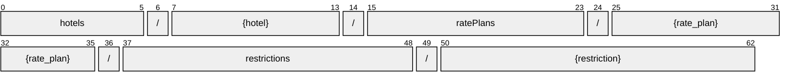

# Restriction

[](https://github.com/OpenTravel/OpenTravel-Specifications)
[](https://github.com/OpenTravel/OpenTravel-Specifications/tree/master/CodeLists)
[](https://aip.dev/121)
[](#methods)
[](v1/)

> [!IMPORTANT]
> Generated by `just docs` from the OpenTravel 2017B XML message suite and
> code list 2024-09-04, OpenTravel-Specifications revision 2024-11-26 (`28dcc88`).
> Do not edit by hand.

The AvailStatusMessage. It is here that one indicates whether the inventory is opened, closed, closed on request, etc.

The MinMaxLOSStatusMessage class communicates the set of minimum and maximum length-of-stay availability status changes to be synchronized with another system.

The RateHurdleStatusMessage class defines the setting for rate hurdle controls to be synchronized with the central reservation system.

OTA: OTA_HotelAvailNotifRQ/AvailStatusMessages/AvailStatusMessage.

```text
hotels/{hotel}/ratePlans/{rate_plan}/restrictions/{restriction}
```

## Example

A restriction as this API returns it:

```json
{
  "name": "hotels/HOT1/ratePlans/RAT1/restrictions/RES1",
  "uid": "b3f1c2de-4a5b-4c6d-8e9f-0a1b2c3d4e5f",
  "createTime": "2026-10-05T10:15:30Z",
  "updateTime": "2026-10-05T10:15:30Z",
  "override": true,
  "bookingLimitMessageType": "BOOKING_LIMIT_MESSAGE_TYPE_REMOVE_LIMIT",
  "bookingLimit": 1,
  "locatorId": 1,
  "bookingThreshold": 1,
  "roomGender": "ROOM_GENDER_MALE"
}
```

## Resource names

Every restriction is addressed by a name that alternates collection and identifier,
per [AIP-122](https://aip.dev/122):



The last segment is assigned by the server, or by the caller as `restriction_id` on create.

## Fields

20 fields: 7 AIP identity and lifecycle, 13 from OTA. Field numbers
8-15 are reserved, so a later identity field never renumbers an OTA one.

| Field | Type | Behavior | OTA | Description |
| --- | --- | --- | --- | --- |
| `override` | `bool` | `OPTIONAL` | `AvailStatusMessageType/@Override` | Mechanism to allow the user to override settings at the reservation system and to allow the RMS to replace this overridden values: If value = "false", the re... |
| `booking_limit_message_type` | `Restriction.BookingLimitMessageType` | `OPTIONAL` | `AvailStatusMessageType/@BookingLimitMessageType` | An enumerated type defining the function of the booking limit message. |
| `booking_limit` | `int32` | `OPTIONAL` | `AvailStatusMessageType/@BookingLimit` | Number of units of inventory that can be sold. |
| `locator_id` | `int32` | `OPTIONAL` | `AvailStatusMessageType/@LocatorID` | Can be used to communicate back to the sender exactly which transaction may have had a problem (e.g. |
| `booking_threshold` | `int32` | `OPTIONAL` | `AvailStatusMessageType/@BookingThreshold` | Number of units down to which inventory can be sold. |
| `room_gender` | `Restriction.RoomGender` | `OPTIONAL` | `AvailStatusMessageType/@RoomGender` | Used to request or specify a gender assignment for a room. |
| `shared_room` | `bool` | `OPTIONAL` | `AvailStatusMessageType/@SharedRoomInd` | If TRUE, the room requires or has sharing available. |
| `stay_lengths` | `LengthsOfStay` | `OPTIONAL` | `AvailStatusMessageType/LengthsOfStay` | Collection of Length of Stay elements. |
| `best_available_rates` | `repeated Restriction.BestAvailableRate` | `OPTIONAL` | `AvailStatusMessageType/BestAvailableRates/BestAvailableRate` | A collection of the best rates available. |
| `hurdle_rate` | `Restriction.HurdleRate` | `OPTIONAL` | `AvailStatusMessageType/HurdleRate` | Restriction based on the minimum rate to be considered for availability, ex. |
| `delta` | `Restriction.Delta` | `OPTIONAL` | `AvailStatusMessageType/Delta` | Incremental amount added to the hurdle rate (e.g. |
| `unique_id` | `UniqueId` | `OPTIONAL` | `AvailStatusMessageType/UniqueID` | The unique identifier element allows the trading partners to uniquely identify each AvailStatusMessage, for tracing of transactions. |
| `restriction_status` | `Restriction.RestrictionStatus` | `OPTIONAL` | `AvailStatusMessageType/RestrictionStatus` | Availability status assigned to the room rate combination. |

<details>
<summary>Identity and lifecycle -- the fields every resource carries</summary>

| Field | Type | Behavior | Description |
| --- | --- | --- | --- |
| `name` | `string` | `IDENTIFIER` | Resource name, "hotels/{hotel}/ratePlans/{rate_plan}/restrictions/{restriction}". |
| `uid` | `string` | `OUTPUT_ONLY` | Server-assigned unique id. |
| `etag` | `string` | `OUTPUT_ONLY` | Weak validator for optimistic concurrency, AIP-154 <https://aip.dev/154>. |
| `delete_time` | `google.protobuf.Timestamp` | `OUTPUT_ONLY` | When this resource was soft-deleted, unset while it is live. |
| `expire_time` | `google.protobuf.Timestamp` | `OUTPUT_ONLY` | When a soft-deleted resource is purged for good. |
| `create_time` | `google.protobuf.Timestamp` | `OUTPUT_ONLY` | When this resource was created. |
| `update_time` | `google.protobuf.Timestamp` | `OUTPUT_ONLY` | When this resource was last modified. |

</details>

## Methods

Service `Restrictions`, the AIP-131..135 standard methods plus [AIP-164](https://aip.dev/164) undelete:

| RPC | HTTP | Description |
| --- | --- | --- |
| `GetRestriction` | `GET /v1/{name=hotels/*/ratePlans/*/restrictions/*}` | Retrieves one Restriction. |
| `UpdateRestriction` | `PATCH /v1/{restriction.name=hotels/*/ratePlans/*/restrictions/*}` | Updates a Restriction. Only the fields in update_mask are written. |
| `ListRestrictions` | `GET /v1/{parent=hotels/*/ratePlans/*}/restrictions` | Lists restrictions, paginated per AIP-158 <https://aip.dev/158>. |
| `CreateRestriction` | `POST /v1/{parent=hotels/*/ratePlans/*}/restrictions` | Creates a Restriction. |
| `DeleteRestriction` | `DELETE /v1/{name=hotels/*/ratePlans/*/restrictions/*}` | Soft-deletes a Restriction; it is purged at expire_time unless restored. |
| `UndeleteRestriction` | `POST /v1/{name=hotels/*/ratePlans/*/restrictions/*}:undelete` | Restores a soft-deleted Restriction before it is purged. |
| `BatchUpdateRestrictions` | `POST /v1/{parent=hotels/*/ratePlans/*}/restrictions:batchUpdate` | Sets restrictions for many days at once. OTA_HotelAvailNotifRQ, its ranges expanded to days. |

## Code tables

Enums numbered by their OTA code, so the wire carries exactly what OTA's XML
does ([decisions](../../../../../docs/decisions.md)):

| Table | Name | Enum | Codes |
| --- | --- | --- | --- |
| `TVS` | Travel Sector | `TravelSector` | 11 |
| `UIT` | Unique Id Type | `UniqueIdType` | 44 |
