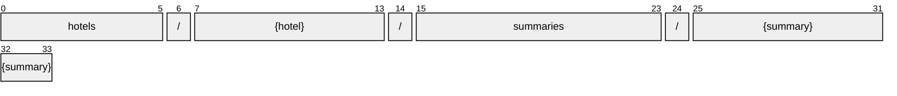

# Summary

[](https://github.com/OpenTravel/OpenTravel-Specifications)
[](https://github.com/OpenTravel/OpenTravel-Specifications/tree/master/CodeLists)
[](https://aip.dev/121)
[](#methods)
[](v1/)

> [!IMPORTANT]
> Generated by `just docs` from the OpenTravel 2017B XML message suite and
> code list 2024-09-04, OpenTravel-Specifications revision 2024-11-26 (`28dcc88`).
> Do not edit by hand.

The HotelSummaryMessage is the message that is used to provide a notification of the general status of availability of the hotel, and its minimum and maximum rates.

OTA: OTA_HotelSummaryNotifRQ/HotelSummaryMessages/HotelSummaryMessage.

```text
hotels/{hotel}/summaries/{summary}
```

## Example

A summary as this API returns it:

```json
{
  "name": "hotels/HOT1/summaries/SUM1",
  "uid": "b3f1c2de-4a5b-4c6d-8e9f-0a1b2c3d4e5f",
  "createTime": "2026-10-05T10:15:30Z",
  "updateTime": "2026-10-05T10:15:30Z",
  "statusType": "STATUS_TYPE_CLOSED",
  "arrivalsOnlyFlag": true
}
```

## Resource names

Every summary is addressed by a name that alternates collection and identifier,
per [AIP-122](https://aip.dev/122):



The last segment is assigned by the server, or by the caller as `summary_id` on create.

## Fields

11 fields: 7 AIP identity and lifecycle, 4 from OTA. Field numbers
8-15 are reserved, so a later identity field never renumbers an OTA one.

| Field | Type | Behavior | OTA | Description |
| --- | --- | --- | --- | --- |
| `status_type` | `Summary.StatusType` | `OPTIONAL` | `HotelSummaryMessagesType/HotelSummaryMessage/@StatusType` | Descibes the status of the inventory (Closed, Open or On Request). |
| `arrivals_only_flag` | `bool` | `OPTIONAL` | `HotelSummaryMessagesType/HotelSummaryMessage/@ArrivalsOnlyFlag` | Used in conjuction with the "closed" enumeration of the StatusType attribute to indicate "Closed to arrival" state. |
| `rate_min` | `Summary.RateMin` | `OPTIONAL` | `HotelSummaryMessagesType/HotelSummaryMessage/RateMin` | The minimum rate that may be available at the hotel. |
| `rate_max` | `Summary.RateMax` | `OPTIONAL` | `HotelSummaryMessagesType/HotelSummaryMessage/RateMax` | The maximum rate that may be available at the hotel. |

<details>
<summary>Identity and lifecycle -- the fields every resource carries</summary>

| Field | Type | Behavior | Description |
| --- | --- | --- | --- |
| `name` | `string` | `IDENTIFIER` | Resource name, "hotels/{hotel}/summaries/{summary}". |
| `uid` | `string` | `OUTPUT_ONLY` | Server-assigned unique id. |
| `etag` | `string` | `OUTPUT_ONLY` | Weak validator for optimistic concurrency, AIP-154 <https://aip.dev/154>. |
| `delete_time` | `google.protobuf.Timestamp` | `OUTPUT_ONLY` | When this resource was soft-deleted, unset while it is live. |
| `expire_time` | `google.protobuf.Timestamp` | `OUTPUT_ONLY` | When a soft-deleted resource is purged for good. |
| `create_time` | `google.protobuf.Timestamp` | `OUTPUT_ONLY` | When this resource was created. |
| `update_time` | `google.protobuf.Timestamp` | `OUTPUT_ONLY` | When this resource was last modified. |

</details>

## Methods

Service `Summaries`, the AIP-131..135 standard methods plus [AIP-164](https://aip.dev/164) undelete:

| RPC | HTTP | Description |
| --- | --- | --- |
| `GetSummary` | `GET /v1/{name=hotels/*/summaries/*}` | Retrieves one Summary. |
| `UpdateSummary` | `PATCH /v1/{summary.name=hotels/*/summaries/*}` | Updates a Summary. Only the fields in update_mask are written. |
| `ListSummaries` | `GET /v1/{parent=hotels/*}/summaries` | Lists summaries, paginated per AIP-158 <https://aip.dev/158>. |
| `CreateSummary` | `POST /v1/{parent=hotels/*}/summaries` | Creates a Summary. |
| `DeleteSummary` | `DELETE /v1/{name=hotels/*/summaries/*}` | Soft-deletes a Summary; it is purged at expire_time unless restored. |
| `UndeleteSummary` | `POST /v1/{name=hotels/*/summaries/*}:undelete` | Restores a soft-deleted Summary before it is purged. |
| `BatchUpdateSummaries` | `POST /v1/{parent=hotels/*}/summaries:batchUpdate` | Sets the hotel's open or closed status for many days at once. OTA_HotelSummaryNotifRQ. |

