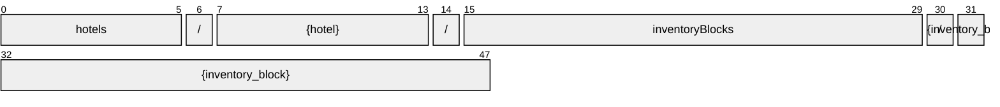

# InventoryBlock

[](https://github.com/OpenTravel/OpenTravel-Specifications)
[](https://github.com/OpenTravel/OpenTravel-Specifications/tree/master/CodeLists)
[](https://aip.dev/121)
[](#methods)
[](v1/)

> [!IMPORTANT]
> Generated by `just docs` from the OpenTravel 2017B XML message suite and
> code list 2024-09-04, OpenTravel-Specifications revision 2024-11-26 (`28dcc88`).
> Do not edit by hand.

This is for creating a single block at a single hotel.

OTA: OTA_HotelInvBlockNotifRQ/InvBlocks/InvBlock.

```text
hotels/{hotel}/inventoryBlocks/{inventory_block}
```

## Example

A inventoryBlock as this API returns it:

```json
{
  "name": "hotels/HOT1/inventoryBlocks/INV1",
  "uid": "b3f1c2de-4a5b-4c6d-8e9f-0a1b2c3d4e5f",
  "createTime": "2026-10-05T10:15:30Z",
  "updateTime": "2026-10-05T10:15:30Z",
  "bookingStatus": "BOOKING_AVAILABILITY_OPEN",
  "invBlockTypeCode": "INVENTORY_BLOCK_TYPE_AIRLINE_CRES",
  "invBlockGroupingCode": "<inv block grouping code>",
  "invBlockDisplayName": "<inv block display name>",
  "invBlockLongDisplayName": "<inv block long display name>",
  "invBlockStatusCode": "INVENTORY_BLOCK_STATUS_CODE_CANCELLED"
}
```

## Resource names

Every inventoryBlock is addressed by a name that alternates collection and identifier,
per [AIP-122](https://aip.dev/122):



The last segment is OTA's `@InvBlockCode`, verbatim -- OTA codes are case-sensitive,
so it is not lower-cased ([decisions](../../../../../docs/decisions.md)).

## Fields

29 fields: 7 AIP identity and lifecycle, 22 from OTA. Field numbers
8-15 are reserved, so a later identity field never renumbers an OTA one.

| Field | Type | Behavior | OTA | Description |
| --- | --- | --- | --- | --- |
| `booking_status` | `InventoryBlock.BookingAvailability` | `OPTIONAL` | `InvBlockGroup/@BookingStatus` | Provides information as to whether the rooms are available for booking. |
| `inv_block_type_code` | `InventoryBlockType` | `OPTIONAL` | `InvBlockGroup/@InvBlockTypeCode` | Describes the type of inventory the block is being created for. |
| `inv_block_grouping_code` | `string` | `OPTIONAL` | `InvBlockGroup/@InvBlockGroupingCode` | This code identifies the inventory group that contains multiple blocks. |
| `inv_block_display_name` | `string` | `OPTIONAL` | `InvBlockGroup/@InvBlockName` | This is the short name of the Inventory Block. |
| `inv_block_long_display_name` | `string` | `OPTIONAL` | `InvBlockGroup/@InvBlockLongName` | This is the full name of the Inventory Block. |
| `inv_block_status_code` | `InventoryBlockStatusCode` | `OPTIONAL` | `InvBlockGroup/@InvBlockStatusCode` | This defines the status of the block. |
| `pms_inv_block_id` | `string` | `OPTIONAL` | `InvBlockGroup/@PMS_InvBlockID` | This is used as a cross reference to the property management system (e.g. |
| `opportunity_id` | `string` | `OPTIONAL` | `InvBlockGroup/@OpportunityID` | This is the identifier (i.e. |
| `inv_block_company_id` | `string` | `OPTIONAL` | `InvBlockGroup/@InvBlockCompanyID` | This is used to identify the company or corporation associated with the inventory block, it is not a direct bill number. |
| `restricted_booking_code_lists` | `repeated UniqueIdType` | `OPTIONAL` | `InvBlockGroup/@RestrictedBookingCodeList` | This is who is allowed to book against the block. |
| `restricted_viewing_code_lists` | `repeated UniqueIdType` | `OPTIONAL` | `InvBlockGroup/@RestrictedViewingCodeList` | This is who is allowed to view the block. |
| `transaction_detail` | `string` | `OPTIONAL` | `InvBlockGroup/@TransactionDetail` | This provides the specific action to be taken on the block according to the TransactionAction attribute. |
| `quote_id` | `string` | `OPTIONAL` | `InvBlockGroup/@QuoteID` | This identifies a specific quote for an inventory block. |
| `inv_block_dates` | `InventoryBlock.InvBlockDates` | `OPTIONAL` | `InvBlockType/InvBlockDates` | This is used to indicate the date or date range applicable to this inventory block. |
| `room_types` | `repeated InvBlockRoom` | `OPTIONAL` | `InvBlockType/RoomTypes/RoomType` | This allows for multiple room types to be defined within an inventory block. |
| `method_info` | `InventoryBlock.MethodInfo` | `OPTIONAL` | `InvBlockType/MethodInfo` | This is used to indicate the reservation and billing methods for a single inventory block. |
| `block_descriptions` | `repeated InventoryBlock.BlockDescription` | `OPTIONAL` | `InvBlockType/BlockDescriptions/BlockDescription` | Collection of free form information about the inventory block. |
| `contacts` | `repeated ContactPerson` | `OPTIONAL` | `InvBlockType/Contacts/Contact` | A collection of contacts. |
| `destination_system_codes` | `repeated string` | `OPTIONAL` | `InvBlockType/DestinationSystemCodes/DestinationSystemCode` | A collection of destination system codes. |
| `tax_info` | `InventoryBlock.TaxInfo` | `OPTIONAL` | `InvBlockType/TaxInformation` | Tax information for the entire group. |
| `guarantee` | `Guarantee` | `OPTIONAL` | `OTA_HotelInvBlockNotifRQ/InvBlocks/InvBlock/Guarantee` | The guarantee information to hold a reservation |
| `market_codes` | `repeated InventoryBlock.MarketCode` | `OPTIONAL` | `OTA_HotelInvBlockNotifRQ/InvBlocks/InvBlock/MarketCode` | This is user specific information used for tracking and market segmentation reporting. |

<details>
<summary>Identity and lifecycle -- the fields every resource carries</summary>

| Field | Type | Behavior | Description |
| --- | --- | --- | --- |
| `name` | `string` | `IDENTIFIER` | Resource name, "hotels/{hotel}/inventoryBlocks/{inventory_block}". |
| `uid` | `string` | `OUTPUT_ONLY` | Server-assigned unique id. |
| `etag` | `string` | `OUTPUT_ONLY` | Weak validator for optimistic concurrency, AIP-154 <https://aip.dev/154>. |
| `delete_time` | `google.protobuf.Timestamp` | `OUTPUT_ONLY` | When this resource was soft-deleted, unset while it is live. |
| `expire_time` | `google.protobuf.Timestamp` | `OUTPUT_ONLY` | When a soft-deleted resource is purged for good. |
| `create_time` | `google.protobuf.Timestamp` | `OUTPUT_ONLY` | When this resource was created. |
| `update_time` | `google.protobuf.Timestamp` | `OUTPUT_ONLY` | When this resource was last modified. |

</details>

## Methods

Service `InventoryBlocks`, the AIP-131..135 standard methods plus [AIP-164](https://aip.dev/164) undelete:

| RPC | HTTP | Description |
| --- | --- | --- |
| `GetInventoryBlock` | `GET /v1/{name=hotels/*/inventoryBlocks/*}` | Retrieves one InventoryBlock. |
| `UpdateInventoryBlock` | `PATCH /v1/{inventory_block.name=hotels/*/inventoryBlocks/*}` | Updates a InventoryBlock. Only the fields in update_mask are written. |
| `ListInventoryBlocks` | `GET /v1/{parent=hotels/*}/inventoryBlocks` | Lists inventoryBlocks, paginated per AIP-158 <https://aip.dev/158>. |
| `CreateInventoryBlock` | `POST /v1/{parent=hotels/*}/inventoryBlocks` | Creates a InventoryBlock. |
| `DeleteInventoryBlock` | `DELETE /v1/{name=hotels/*/inventoryBlocks/*}` | Soft-deletes a InventoryBlock; it is purged at expire_time unless restored. |
| `UndeleteInventoryBlock` | `POST /v1/{name=hotels/*/inventoryBlocks/*}:undelete` | Restores a soft-deleted InventoryBlock before it is purged. |

## Code tables

Enums numbered by their OTA code, so the wire carries exactly what OTA's XML
does ([decisions](../../../../../docs/decisions.md)):

| Table | Name | Enum | Codes |
| --- | --- | --- | --- |
| `AQC` | Age Qualifying Code | `AgeQualifyingCode` | 21 |
| `AUT` | Address Use Type | `AddressUseType` | 13 |
| `CHG` | Charge Type | `ChargeType` | 34 |
| `CLT` | Communication Location Type | `CommunicationLocationType` | 4 |
| `DOC` | Document Type | `DocumentType` | 25 |
| `DTB` | Distribution Type | `DistributionType` | 16 |
| `EAT` | Email Address Type | `EmailAddressType` | 8 |
| `EMP` | Employee Status | `EmployeeStatusCode` | 4 |
| `EWT` | Error Warning Type | `ErrorWarningType` | 13 |
| `FTT` | Fee Tax Type | `FeeTaxType` | 70 |
| `IBS` | Inventory Block Status | `InventoryBlockStatusCode` | 8 |
| `IBT` | Inventory Block Type | `InventoryBlockType` | 21 |
| `INV` | Inventory Count Type | `InventoryCountType` | 21 |
| `MPT` | Meal Plan Type | `MealPlanType` | 27 |
| `NAM` | Name Type | `NameType` | 4 |
| `PLT` | Phone Location Type | `PhoneLocationType` | 10 |
| `PMT` | Payment Type | `PaymentType` | 50 |
| `PTT` | Phone Technology Type | `PhoneTechnologyType` | 8 |
| `PUT` | Phone Use Type | `PhoneUseType` | 10 |
| `RMA` | Room Amenity Type | `RoomAmenityType` | 378 |
| `RMC` | Reservation Method Code | `ReservationMethodCode` | 11 |
| `TVS` | Travel Sector | `TravelSector` | 11 |
| `UIT` | Unique Id Type | `UniqueIdType` | 44 |
